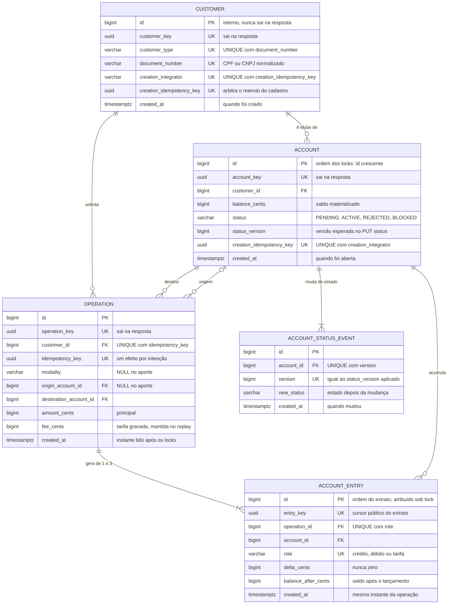

# RFC — Protótipo bancário com movimentação idempotente e extrato que reconstrói o saldo

| | |
|---|---|
| **Time** | Caio Cidade Rodrigues · Caio Vilquer Carvalho · Matheus Victor Barbosa dos Santos |
| **Data** | 12/10/2026 |
| **Versão** | 8 |

## Contextualização

### Entendendo o problema

Um integrador de backend opera, em nome de clientes PF e PJ, o cadastro, a abertura de contas com
análise cadastral, aportes de sandbox, transferências internas e Pix simulado com tarifa, e a
consulta de saldo e extrato. A garantia é sobre o dinheiro: cada intenção do cliente produz no
máximo um efeito, nenhum saldo fica negativo e o extrato reconstrói o saldo lançamento a
lançamento, inclusive a tarifa. Se der errado, um timeout seguido de reenvio debita duas vezes,
dois débitos simultâneos deixam a conta negativa, uma tarifa cobrada não aparece no histórico ou
uma resposta perdida leva o cliente a repetir uma operação que já aconteceu.

Fora do escopo desta entrega: liquidação externa e Pix real (SPI/DICT), crédito, conta conjunta,
estorno, encerramento de conta, câmbio, frontend, login próprio e múltiplos integradores. Todos os
dados são fictícios.

### Explicando a solução de forma macro

Um monólito FastAPI sobre um único PostgreSQL 16, com as versões fixadas pela base do bootcamp.
Cliente, conta, operação e lançamentos vivem no mesmo banco, então cada movimentação confirma
operação, lançamentos e saldos num único COMMIT. A unicidade da chave de idempotência no banco
decide o que é repetição; locks de linha em ordem fixa (cliente, depois contas por id crescente)
decidem quem debita primeiro; o saldo materializado muda de forma relativa, junto do lançamento
que o explica. O bureau cadastral é um serviço externo simulado (MockServer), consultado sempre
fora de transação: se ele falha, a conta fica PENDING e o mesmo pedido, com a mesma chave, retoma
a análise. O integrador autentica os usuários; a API confere, a cada pedido, se a conta pertence
ao cliente declarado.

- `Microsserviços para cliente, conta e operação` — descartada porque débito, crédito e tarifa
  deixariam de caber num único COMMIT e exigiriam saga e reconciliação. Ganharia se as partes
  precisassem escalar ou ser implantadas de forma independente, por times diferentes.
- `Isolamento SERIALIZABLE no lugar de locks explícitos` — descartada porque abortos de
  serialização obrigariam a reexecutar a transação em todos os caminhos de escrita. Ganharia se
  houvesse muitos caminhos de escrita com acesso imprevisível, em que manter uma ordem global de
  locks fosse inviável.
- `Chave de idempotência em cache com TTL de 24 h` — descartada porque uma intenção incerta
  reenviada depois da expiração seria debitada de novo. Ganharia se o volume de chaves impedisse
  guardá-las junto do fato financeiro e o consumidor tivesse prazo garantido para reenviar.
- `Paginação do extrato por offset` — descartada porque lançamentos novos deslocam as páginas
  durante a navegação. Ganharia se o consumidor precisasse saltar para uma página arbitrária ou
  exibir o total de itens.

## Implementação

### Rotas

Valem para todas as rotas de negócio: `403` sem INTERNAL-TOKEN válido (QIT000002) ou sem
CUSTOMER-KEY, exceto no cadastro (QIT000005); `400` para JSON fora do contrato, campo extra, valor
monetário não inteiro, UUID inválido ou Idempotency-Key ausente nas escritas (QIT000001); `503` se
o banco falha antes do COMMIT (QIT001014) e, nas escritas, se a confirmação do COMMIT se perde
(QIT001027, resultado desconhecido); `500` em falha inesperada (QIT000500), que também não prova
rollback. Caminho inexistente responde `404` (QIT000404) e método não suportado, `405`
(QIT000405). As consultas só leem e são idempotentes; as rotas paginadas recusam parâmetro de
query desconhecido ou repetido com `400`.

| Método | Caminho | O que faz | Entrada (campos que importam) | Saídas (status e quando) |
|---|---|---|---|---|
| `POST` | `/customers` | Cadastra cliente PF ou PJ. Idempotente: Idempotency-Key única por integrador (`UNIQUE(creation_integrator, creation_idempotency_key)`), com o pedido normalizado comparado no reenvio. | `customer_type`, `document_number`, `name`; Idempotency-Key | `201` cliente criado ou reenvio do mesmo pedido; `409` documento já cadastrado (QIT001004) ou chave usada com outro pedido (QIT001012); `422` CPF ou CNPJ reprovado no dígito verificador ou com todos os dígitos iguais (QIT001003) |
| `GET` | `/customers/{customer_key}` | Devolve o cadastro do próprio cliente. | `customer_key` igual à CUSTOMER-KEY | `200`; `404` cliente ausente ou de outro contexto (QIT001008) |
| `POST` | `/accounts` | Abre conta PENDING e consulta o bureau fora da transação. Idempotente pela Idempotency-Key única por integrador; o reenvio retoma uma conta ainda PENDING. | `customer_key` igual ao contexto; Idempotency-Key | `201` `opening_result=APPROVED`, também no reenvio; `404` cliente ausente ou diferente do contexto (QIT001008); `409` chave usada com outro pedido (QIT001012); `422` bureau recusou (QIT001030, com `details.account_key`); `503` bureau falhou e a conta segue PENDING (QIT001031) |
| `GET` | `/accounts` | Lista as contas do cliente do contexto, por id crescente. | `page` 0 a 999999999 (padrão 0); `limit` 1 a 100 (padrão 10) | `200` `data`, `page`, `limit`, `is_last_page`; `400` paginação fora da faixa (QIT000001) |
| `GET` | `/accounts/{account_key}` | Saldo, moeda, estado e versão da conta. | conta do cliente do contexto | `200`; `404` conta ausente ou de outro cliente, com a mesma resposta nos dois casos (QIT001009) |
| `PUT` | `/accounts/{account_key}/status` | Bloqueia ou desbloqueia. Idempotente pela versão: o reenvio da última transição devolve o mesmo resultado, sem novo evento. | `status` ACTIVE ou BLOCKED; `reason` com texto visível, até 240; `expected_version` | `200` `account_key`, `status`, `status_version`; `404` conta (QIT001009); `409` versão obsoleta (QIT001034) ou conta PENDING ou REJECTED (QIT001029) |
| `POST` | `/accounts/{account_key}/deposits` | Aporte de sandbox na própria conta. Idempotente: `UNIQUE(customer_id, idempotency_key)`, uma chave por intenção em todas as contas e rotas monetárias do cliente. | `amount_cents` inteiro de 1 a 2^53−1; Idempotency-Key | `201` `operation_key`, também no reenvio; `403` sandbox desligado para aporte novo (QIT001035); `404` conta (QIT001009); `409` conta PENDING ou REJECTED (QIT001029), teto de saldo (QIT001013) ou chave usada com outro pedido (QIT001012) |
| `POST` | `/accounts/{account_key}/transfers` | Transfere da própria conta para outra, de qualquer cliente; tarifa pelo tipo do titular e pela modalidade. Idempotente pela mesma `UNIQUE(customer_id, idempotency_key)`. | `destination_account_key`; `amount_cents`; `modality` INTERNAL ou PIX_SIMULATED; Idempotency-Key | `201` `operation_key`, também no reenvio; `404` conta (QIT001009) ou destino (QIT001026); `409` saldo para principal mais tarifa (QIT001011), estado (QIT001029), teto do destino (QIT001013), quota Pix (QIT001032) ou chave usada com outro pedido (QIT001012); `422` origem igual ao destino (QIT001010) |
| `GET` | `/accounts/{account_key}/statement` | Extrato da conta, do mais recente ao mais antigo, paginado por cursor. | `cursor` (entry_key); `limit` 1 a 100; `created_at_from` e `created_at_to` RFC3339 com fuso | `200` `data`, `limit`, `next_cursor`, `is_last_page`; `400` cursor inválido ou de outra conta (QIT001033), data inválida (QIT000001) ou início que não precede o fim (QIT000010); `404` conta (QIT001009) |
| `GET` | `/accounts/{account_key}/transactions/{operation_key}` | Lançamentos da operação nesta conta, em ordem crescente, sem dados da contraparte. | `operation_key` com lançamento na conta | `200`; `404` conta (QIT001009) ou operação sem lançamento nela (QIT001028) |
| `GET` | `/` | Identifica o serviço; público. | nenhuma | `200` `{"service":"banking-api"}` |
| `GET` | `/health_check` | Liveness pública: o processo responde. | nenhuma | `204` |
| `GET` | `/readiness` | Readiness: banco e schema prontos. | MONITORING-TOKEN | `204`; `403` credencial ausente ou inválida (QIT000004); `503` banco indisponível (QIT001014) |

### Banco de Dados (Somente diagrama)

### Fluxos

**Transferência — caminho feliz**

1. Validar o contrato, o INTERNAL-TOKEN e a CUSTOMER-KEY; autorizar a conta de origem; resolver
   o destino e recusar origem igual ao destino.
2. Reservar a intenção: `INSERT` da operação com
   `ON CONFLICT (customer_id, idempotency_key) DO NOTHING RETURNING`, na mesma transação do débito.
3. No Pix, travar a linha do cliente; depois, origem e destino com `FOR NO KEY UPDATE`, sempre por
   id crescente, e reler saldo e estado.
4. Ler `clock_timestamp()` uma vez, já com os locks, e conferir estado, saldo para principal mais
   tarifa, teto do destino e, no Pix, a quota da janela de São Paulo.
5. `UPDATE` relativo com `RETURNING` em cada conta e um lançamento por efeito: principal e tarifa
   na origem, principal no destino.
6. Um único `COMMIT` confirma operação, lançamentos e saldos; só então a API responde `201` com
   `operation_key`. O aporte segue o mesmo caminho, sem origem nem tarifa.

**Transferência — falha: dois débitos concorrentes sem saldo para ambos**

1. Saldo de 10.000 e duas transferências INTERNAL de 7.000, com chaves diferentes, chegando
   juntas a duas instâncias da API.
2. As duas reservam suas chaves, que não conflitam. A primeira obtém o lock da origem; a segunda
   espera no `FOR NO KEY UPDATE`.
3. A primeira debita principal e tarifa, confirma e libera o lock. A segunda relê o saldo
   restante (2.800, para PF) e recusa.
4. A recusa desfaz a transação inteira, inclusive a reserva: não sobra operação nem lançamento, e
   a mesma chave pode ser reavaliada depois. O cliente recebe `409` QIT001011.

**Transferência — falha: confirmação do COMMIT perdida**

1. O banco confirma o COMMIT, mas a conexão cai antes de a confirmação chegar à API.
2. A API não presume rollback: responde `503` QIT001027 e registra o resultado como desconhecido.
3. O cliente reenvia a mesma chave e o mesmo corpo, com espera de 0,5, 1, 2 e 4 s, sem nunca
   trocar a chave da intenção.
4. O `INSERT ... ON CONFLICT` encontra a operação confirmada; um `SELECT` separado em READ
   COMMITTED a lê e compara tipo, modalidade, contas e valor.
5. Igual: `201` com a mesma `operation_key`, sem novo débito, tarifa ou consumo de quota.
   Diferente: `409` QIT001012. Se o COMMIT não tinha acontecido, o reenvio executa a transferência.

**Abertura de conta — caminho feliz**

1. Arbitrar a Idempotency-Key e gravar a conta PENDING (saldo zero, versão 1) com o evento
   inicial, numa transação curta já confirmada.
2. Fechar transação e sessão antes do HTTP e consultar o bureau, com 3 s de conexão e 5 s de
   leitura, sem retry interno.
3. Abrir outra transação, travar a conta com `FOR NO KEY UPDATE` e reler: só uma conta ainda
   PENDING recebe a conclusão.
4. REGULAR leva a ACTIVE; IRREGULAR ou NOT_FOUND, a REJECTED. Estado, versão e evento com a
   evidência do bureau entram no mesmo COMMIT. A API responde `201` APPROVED ou `422` QIT001030.

**Abertura de conta — falha: bureau indisponível**

1. Timeout, erro HTTP ou resposta fora do contrato: nada muda no banco e a conta segue PENDING.
2. A API responde `503` QIT001031 com `details.account_key`.
3. O integrador reenvia o mesmo POST com a mesma chave: a conta existente é reaproveitada e o
   bureau, consultado de novo. Se outra tentativa concluiu antes, vale a decisão gravada.

**Bloqueio de conta — caminho feliz**

1. Travar a conta com `FOR NO KEY UPDATE` e reler estado e `status_version`; só ACTIVE e BLOCKED
   aceitam o comando.
2. Versão esperada igual à atual: mudar o estado, incrementar a versão e gravar o evento no mesmo
   COMMIT (`200`). Se o estado já é o pedido, `200` sem novo evento.
3. Versão atual igual à esperada mais um, com o último evento de mesmo destino e motivo: é o
   reenvio da última transição, que devolve o mesmo resultado.

**Bloqueio de conta — falha: versão obsoleta**

1. Qualquer outra versão recebe `409` QIT001034, e nada muda.
2. Por isso um bloqueio antigo, reenviado depois de um desbloqueio, não volta a valer.

> **Principal desafio**
>
> - **Qual é:** fazer cada intenção financeira produzir exatamente um efeito (nenhum débito
>   duplicado, saldo nunca negativo, extrato que reconstrói o saldo) com requisições concorrentes,
>   reenvios e respostas perdidas.
> - **Por que é difícil:** a solução óbvia, "procurar a chave, ler o saldo, debitar", quebra em três
>   cenários: dois débitos de chaves diferentes leem o mesmo saldo de 10.000 e debitam 7.000 cada;
>   o mesmo pedido reenviado após timeout passa pela consulta antes que o primeiro confirme; e um
>   503 depois do COMMIT não prova que nada aconteceu.
> - **Como o desenho resolve:** `INSERT ... ON CONFLICT (customer_id, idempotency_key) DO NOTHING`
>   arbitra a repetição no banco, e um `SELECT` separado em READ COMMITTED devolve o replay;
>   `FOR NO KEY UPDATE` nas contas por id crescente (no Pix, depois do lock do cliente) serializa
>   saldo, estado e quota; `UPDATE` relativo com `RETURNING` e os lançamentos entram no mesmo
>   `COMMIT`; confirmação perdida vira 503/QIT001027 e se recupera reenviando a mesma chave.
