# RFC: Protótipo bancário com movimentação idempotente e extrato que reconstrói o saldo

| | |
|---|---|
| **Time** | Caio Cidade Rodrigues · Caio Vilquer Carvalho · Matheus Victor Barbosa dos Santos |
| **Data** | 12/10/2026 |
| **Versão** | 8 |

## Contextualização

### Entendendo o problema

Um integrador de backend opera, em nome de clientes PF e PJ, o cadastro, a abertura de contas com
análise cadastral, aportes de sandbox, transferências internas e Pix simulado com tarifa, e a
consulta de saldo e extrato. A garantia é sobre o dinheiro: cada intenção do cliente produz no
máximo um efeito, nenhum saldo fica negativo e o extrato reconstrói o saldo lançamento a
lançamento, inclusive a tarifa. Se der errado, um timeout seguido de reenvio debita duas vezes,
dois débitos simultâneos deixam a conta negativa, uma tarifa cobrada não aparece no histórico ou
uma resposta perdida leva o cliente a repetir uma operação que já aconteceu.

Fora do escopo desta entrega: liquidação externa e Pix real (SPI/DICT), crédito, conta conjunta,
estorno, encerramento de conta, câmbio, frontend, login próprio e múltiplos integradores. Todos os
dados são fictícios.

### Explicando a solução de forma macro

Um monólito FastAPI sobre um único PostgreSQL 16, com as versões fixadas pela base do bootcamp.
Cliente, conta, operação e lançamentos vivem no mesmo banco, então cada movimentação confirma
operação, lançamentos e saldos num único COMMIT. A unicidade da chave de idempotência no banco
decide o que é repetição; locks de linha em ordem fixa (cliente, depois contas por id crescente)
decidem quem debita primeiro; o saldo materializado muda de forma relativa, junto do lançamento
que o explica. O bureau cadastral é um serviço externo simulado (MockServer), consultado sempre
fora de transação: se ele falha, a conta fica PENDING e o mesmo pedido, com a mesma chave, retoma
a análise. O integrador autentica os usuários; a API confere, a cada pedido, se a conta pertence
ao cliente declarado.

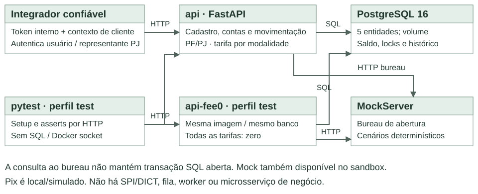

Dentro da API, cada pedido atravessa as mesmas camadas da base. O resource valida formato e
cabeçalhos sem tocar no banco; o controller autoriza, aplica as regras e é o único que decide o
COMMIT; o repository executa SQL sem confirmar nada; o DTO escolhe o que sai na resposta.

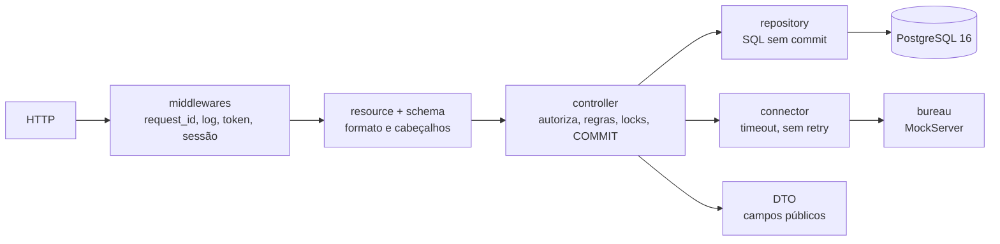

Cada decisão abaixo traz o motivo, a alternativa que foi considerada e descartada, com o cenário
em que ela seria a melhor escolha, e o custo que o time aceitou pagar.

| Decisão | Por que foi tomada | Alternativa descartada e quando ela ganharia | Custo aceito |
|---|---|---|---|
| Monólito sobre um único PostgreSQL | Cliente, conta, tarifa e lançamentos dividem a mesma fronteira de COMMIT, e é essa fronteira que dá a garantia sobre o dinheiro. | Microsserviços para cliente, conta e operação. Débito, crédito e tarifa deixariam de caber num único COMMIT e pediriam saga e reconciliação. Ganhariam se as partes precisassem escalar ou ser implantadas separadamente, por times diferentes. | Implantação e disponibilidade são compartilhadas por todas as partes. |
| Clientes PF e PJ, um titular por conta e várias contas por cliente | O mesmo núcleo atende os dois tipos de cliente e permite exercitar a autorização entre contas e os limites compartilhados. | Atender só PF, que reduziria o escopo e deixaria a tarifa por tipo de titular sem uso, ou conta conjunta, que pediria outro modelo de titularidade. A conta conjunta ganharia se o produto exigisse cotitulares. | Dois validadores de documento e quatro combinações de tarifa para testar. A quota Pix é do cliente e não se multiplica por conta. |
| Identidade delegada ao integrador, com INTERNAL-TOKEN e CUSTOMER-KEY | O integrador já autentica os usuários e os representantes de empresas. A API só precisa conferir os vínculos entre cliente, conta e lançamento. | Um token pessoal por correntista, que duplicaria emissão, entrega, recuperação e rotação de segredo. Ganharia se os usuários acessassem a API diretamente ou se houvesse vários integradores. | Um integrador comprometido pode declarar qualquer cliente dele. Por isso a API confere cliente e conta em todo pedido e o token nunca sai do backend. |
| Bureau simulado, consultado fora da transação, com a conta PENDING gravada antes | O simulador dá resultados reproduzíveis, sem custo e sem dados reais. Uma chamada HTTP externa não pode segurar lock nem conexão do banco, e a falha do bureau vira um estado que o mesmo pedido retoma. | Uma fila com worker que concluísse a análise sozinho. Seria mais uma peça para operar e monitorar. Ganharia se a conta precisasse ser concluída sem depender de um reenvio do integrador. | Sem reenvio, a conta pode ficar PENDING por tempo indefinido. A dívida informada pelo bureau é só registrada, porque o produto não oferece crédito. |
| Estado atual, eventos e versão na conta | O estado responde às consultas, os eventos explicam cada mudança e a versão separa um comando antigo de uma decisão nova. | Guardar só o status. Perderia a trilha das mudanças e deixaria um bloqueio antigo valer de novo depois de um desbloqueio. Ganharia se não houvesse comandos concorrentes nem necessidade de auditoria. | O integrador precisa enviar a versão que leu, e estado e evento são confirmados sempre juntos. |
| Pix local, com quota por cliente somada dos lançamentos confirmados | Exercita uma modalidade com regra própria sem liquidação externa. Somar os lançamentos evita um segundo número para reconciliar com o histórico. | Um contador de quota em tabela própria, que tornaria a leitura mais barata mas criaria outro estado para manter coerente. Ganharia com muitos Pix por cliente na mesma janela. | Uma soma por Pix, feita sob o lock do cliente. Um Pix real, com SPI e DICT, pediria outro desenho. |
| Dinheiro em centavos inteiros (BIGINT), com teto de 2^53−1 | Inteiro não tem erro de ponto flutuante nem pede regra de arredondamento, e o teto cabe num número JSON lido por JavaScript. | NUMERIC ou decimal. Ganharia com juros, câmbio ou escala variável, que estão fora do escopo. | Valores fracionários de centavo não são representáveis. |
| Saldo materializado na conta e um lançamento por efeito | O saldo se lê direto, e o histórico explica e reconcilia cada mudança. | Calcular o saldo somando o histórico a cada consulta. Tiraria a redundância, mas encareceria toda leitura e não dispensaria coordenar os débitos. Ganharia com histórico curto e leitura rara. | Toda escrita precisa atualizar saldo e histórico na mesma transação, e os testes conferem que os dois sempre batem. |
| Chave de idempotência arbitrada por `UNIQUE` no banco, sem expirar | Só a unicidade resolve a corrida entre processos: consultar antes e inserir depois deixa uma janela. A recusa desfaz a reserva, e o reenvio devolve o fato original com a tarifa que foi gravada. | Chave em cache com TTL de 24 h. Uma intenção incerta reenviada depois da expiração seria debitada de novo. Ganharia se o volume de chaves impedisse guardá-las junto do fato financeiro e o consumidor tivesse prazo garantido para reenviar. | A chave fica guardada enquanto o fato financeiro existir. |
| READ COMMITTED com `FOR NO KEY UPDATE` em ordem fixa | `NO KEY UPDATE` serializa saldo e estado sem bloquear a checagem das chaves estrangeiras de quem insere uma operação para a mesma conta. Em READ COMMITTED, o `SELECT` feito depois do `ON CONFLICT` enxerga o vencedor recém-confirmado. | Isolamento SERIALIZABLE, cujos abortos obrigariam a reexecutar a transação em todos os caminhos de escrita. Ganharia com muitos caminhos de escrita de acesso imprevisível, em que uma ordem global de locks fosse inviável. | Todo caminho de escrita precisa seguir a ordem cliente, depois contas por id, com leitura fresca e atualização relativa do saldo. |
| Instante lido com `clock_timestamp()` depois dos locks | A janela do Pix e o extrato usam o instante em que a regra foi de fato avaliada. | Usar `now()`, que é o início da transação e ficaria anterior a uma espera longa por lock. Ganharia se nenhuma regra dependesse do horário. | Uma leitura extra do relógio por escrita. |
| Saldo na própria conta, detalhe por conta e extrato por cursor | A consulta da conta já devolve o saldo, cada titular vê só os lançamentos da sua conta e o cursor mantém a posição enquanto entram lançamentos novos. | Uma rota de saldo separada, que duplicaria o dado, e paginação por offset, em que lançamentos novos deslocam as páginas. O offset ganharia se fosse preciso saltar para uma página arbitrária ou exibir o total de itens. | O extrato não tem total nem salto de página, e saldo, extrato e detalhe são leituras independentes, sem instantâneo comum. |
| Testes por HTTP, com PostgreSQL real e só o bureau simulado | Exercitam o contrato e os efeitos entre processos, que é onde a concorrência acontece. | Testes com repositório simulado, mais rápidos, mas que não provariam concorrência real. Ganhariam para regra pura, sem banco. | A suíte custa mais para rodar, e concorrência e recuperação são ensaiadas em etapas separadas. |

Tarifas e quotas são configuração da demonstração, mas a tarifa gravada numa operação é fato
histórico e não muda. Serviços externos não participam do rollback do PostgreSQL: o bureau só
informa a situação cadastral. Pagamentos externos pediriam rever confirmação, recuperação e
reconciliação numa nova RFC.

## Implementação

### Rotas

O integrador percorre as rotas na ordem abaixo. Cada escrita devolve o identificador público que a
rota seguinte recebe: `customer_key` vira o contexto CUSTOMER-KEY, `account_key` entra no caminho e
`operation_key` identifica a movimentação no detalhe.

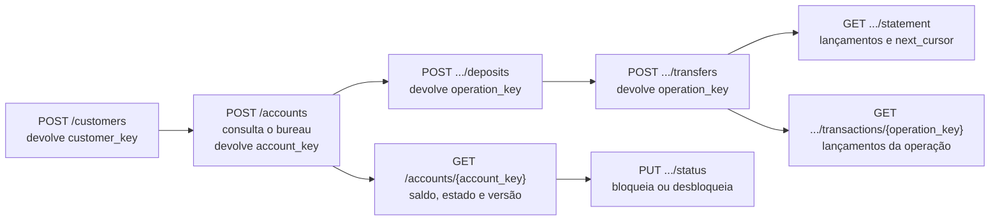

Toda rota de negócio passa pelos mesmos filtros antes da regra de domínio, e a primeira recusa
encerra o pedido. Por isso a tabela lista só as saídas próprias de cada rota; as comuns são estas:

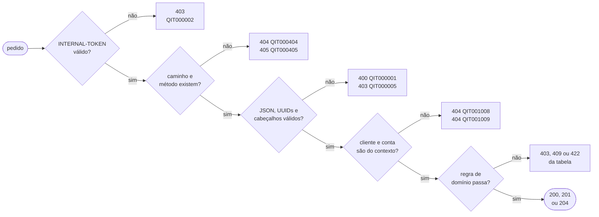

Em qualquer ponto depois da autorização, falha de banco ou de pool antes do COMMIT responde `503`
(QIT001014); nas escritas, confirmação de COMMIT perdida responde `503` (QIT001027, resultado
desconhecido); falha inesperada responde `500` (QIT000500), que também não prova rollback. O `400`
cobre JSON fora do contrato, campo extra, valor monetário não inteiro, UUID inválido e
Idempotency-Key ausente nas escritas; o `403` QIT000005 é a CUSTOMER-KEY ausente, exigida em todas
as rotas de negócio menos o cadastro. As consultas só leem e são idempotentes; as rotas paginadas
recusam parâmetro de query desconhecido ou repetido com `400`.

| Método | Caminho | O que faz | Entrada (campos que importam) | Saídas (status e quando) |
|---|---|---|---|---|
| `POST` | `/customers` | Cadastra cliente PF ou PJ. Idempotente: Idempotency-Key única por integrador (`UNIQUE(creation_integrator, creation_idempotency_key)`), com o pedido normalizado comparado no reenvio. | `customer_type`, `document_number`, `name`; Idempotency-Key | `201` cliente criado ou reenvio do mesmo pedido; `409` documento já cadastrado (QIT001004) ou chave usada com outro pedido (QIT001012); `422` CPF ou CNPJ reprovado no dígito verificador ou com todos os dígitos iguais (QIT001003) |
| `GET` | `/customers/{customer_key}` | Devolve o cadastro do próprio cliente. | `customer_key` igual à CUSTOMER-KEY | `200`; `404` cliente ausente ou de outro contexto (QIT001008) |
| `POST` | `/accounts` | Abre conta PENDING e consulta o bureau fora da transação. Idempotente pela Idempotency-Key única por integrador; o reenvio retoma uma conta ainda PENDING. | `customer_key` igual ao contexto; Idempotency-Key | `201` `opening_result=APPROVED`, também no reenvio; `404` cliente ausente ou diferente do contexto (QIT001008); `409` chave usada com outro pedido (QIT001012); `422` bureau recusou (QIT001030, com `details.account_key`); `503` bureau falhou e a conta segue PENDING (QIT001031) |
| `GET` | `/accounts` | Lista as contas do cliente do contexto, por id crescente. | `page` 0 a 999999999 (padrão 0); `limit` 1 a 100 (padrão 10) | `200` `data`, `page`, `limit`, `is_last_page`; `400` paginação fora da faixa (QIT000001) |
| `GET` | `/accounts/{account_key}` | Saldo, moeda, estado e versão da conta. | conta do cliente do contexto | `200`; `404` conta ausente ou de outro cliente, com a mesma resposta nos dois casos (QIT001009) |
| `PUT` | `/accounts/{account_key}/status` | Bloqueia ou desbloqueia. Idempotente pela versão: o reenvio da última transição administrativa devolve o mesmo resultado, sem novo evento. | `status` ACTIVE ou BLOCKED; `reason` com texto visível, até 240; `expected_version` | `200` `account_key`, `status`, `status_version`; `404` conta (QIT001009); `409` versão obsoleta (QIT001034) ou conta PENDING ou REJECTED (QIT001029) |
| `POST` | `/accounts/{account_key}/deposits` | Aporte de sandbox na própria conta. Idempotente: `UNIQUE(customer_id, idempotency_key)`, uma chave por intenção em todas as contas e rotas monetárias do cliente. | `amount_cents` inteiro de 1 a 2^53−1; Idempotency-Key | `201` `operation_key`, também no reenvio; `403` sandbox desligado para aporte novo (QIT001035); `404` conta (QIT001009); `409` conta PENDING ou REJECTED (QIT001029), teto de saldo (QIT001013) ou chave usada com outro pedido (QIT001012) |
| `POST` | `/accounts/{account_key}/transfers` | Transfere da própria conta para outra, de qualquer cliente; tarifa pelo tipo do titular e pela modalidade. Idempotente pela mesma `UNIQUE(customer_id, idempotency_key)`. | `destination_account_key`; `amount_cents`; `modality` INTERNAL ou PIX_SIMULATED; Idempotency-Key | `201` `operation_key`, também no reenvio; `404` conta (QIT001009) ou destino (QIT001026); `409` saldo para principal mais tarifa (QIT001011), estado (QIT001029), teto do destino (QIT001013), quota Pix (QIT001032) ou chave usada com outro pedido (QIT001012); `422` origem igual ao destino (QIT001010) |
| `GET` | `/accounts/{account_key}/statement` | Extrato da conta, do mais recente ao mais antigo, paginado por cursor. | `cursor` (entry_key); `limit` 1 a 100; `created_at_from` e `created_at_to` RFC3339 com fuso | `200` `data`, `limit`, `next_cursor`, `is_last_page`; `400` cursor inválido ou de outra conta (QIT001033), data inválida (QIT000001) ou início que não precede o fim (QIT000010); `404` conta (QIT001009) |
| `GET` | `/accounts/{account_key}/transactions/{operation_key}` | Lançamentos da operação nesta conta, em ordem crescente, sem dados da contraparte. | `operation_key` com lançamento na conta | `200`; `404` conta (QIT001009) ou operação sem lançamento nela (QIT001028) |
| `GET` | `/` | Identifica o serviço; público. | nenhuma | `200` `{"service":"banking-api"}` |
| `GET` | `/health_check` | Liveness pública: o processo responde. | nenhuma | `204` |
| `GET` | `/readiness` | Readiness: banco e schema prontos. | MONITORING-TOKEN | `204`; `403` credencial ausente ou inválida (QIT000004); `503` banco indisponível (QIT001014) |

Os cabeçalhos carregam a identidade e a intenção; nenhum deles vai no corpo:

| Cabeçalho | Quem envia e para quê |
|---|---|
| INTERNAL-TOKEN | Credencial do integrador em todas as rotas de negócio. Fica só no backend dele. |
| CUSTOMER-KEY | `customer_key` do cliente em nome de quem o integrador age. É declaração do integrador, não segredo: a API confere se cada conta pertence a esse cliente. |
| Idempotency-Key | UUID de uma intenção de escrita. Novo UUID é nova intenção; para recuperar uma resposta perdida, reenvia-se o mesmo. Não expira. |
| MONITORING-TOKEN | Credencial separada, aceita só em `/readiness`; não autoriza operação financeira. |
| X-Request-ID | Opcional. Correlaciona o pedido com o log e volta em toda resposta; se faltar, a API gera um. |

A transferência cobra a tarifa da origem conforme o tipo do titular e a modalidade; o destino
recebe só o principal. O Pix simulado tem ainda uma quota por cliente, somada entre todas as
contas dele, que só o principal enviado consome. Valores em centavos de BRL, configuráveis e
validados na subida da API:

| Regra | PF | PJ |
|---|---|---|
| Tarifa INTERNAL | 200 | 500 |
| Tarifa PIX_SIMULATED | 0 | 100 |
| Aporte de sandbox | 0 | 0 |
| Quota Pix das 06h às 20h (America/Sao_Paulo) | 1.000.000 | 1.000.000 |
| Quota Pix das 20h às 06h do dia seguinte | 100.000 | 100.000 |

Um exemplo completo de escrita, com o sucesso e o envelope de erro que todas as recusas seguem
(`description` em inglês, `translation` em português, `details` só nas recusas de abertura):

```text
POST /accounts/7b1f.../transfers
INTERNAL-TOKEN: <credencial do integrador>
CUSTOMER-KEY: 3d9a...            Idempotency-Key: 00000000-0000-4000-8000-000000000004
{"destination_account_key": "c41e...", "amount_cents": 5000, "modality": "INTERNAL"}

201  {"operation_key": "9f02..."}
409  {"title": "Banking request error", "description": "Insufficient funds",
      "translation": "Saldo insuficiente", "code": "QIT001011"}
```

Com saldo de 10.000 numa conta PF, esse pedido deixa 4.800 na origem (5.000 de principal e 200 de
tarifa) e credita 5.000 no destino: 4.800 + 5.000 + 200 = 10.000.

### Banco de Dados (Somente diagrama)


### Fluxos

**Cadastro de cliente: caminho feliz**

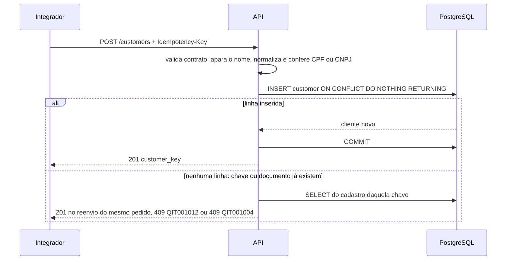

1. Validar o contrato e a Idempotency-Key; aparar o nome e normalizar o documento: tirar a
   pontuação, pôr as letras do CNPJ em maiúsculas e conferir os dígitos verificadores, sem nunca
   tratar o documento como número.
2. `INSERT ... ON CONFLICT DO NOTHING RETURNING` do cliente, com o pedido normalizado guardado em
   `creation_request`, e COMMIT. A API responde `201` com `customer_key`.

**Cadastro de cliente, falha: o INSERT não devolve linha**

1. Outra linha já ocupa a chave de idempotência ou o par tipo e documento. Um `SELECT` separado
   procura o cadastro daquela chave.
2. Não achou: o conflito foi no documento, de outra chave. `409` QIT001004, sem criar cliente.
3. Achou com o mesmo pedido normalizado: é reenvio, e a API devolve `201` com a `customer_key`
   original. Achou com pedido diferente: `409` QIT001012. Nos dois casos a transação é desfeita.

**Abertura de conta: caminho feliz e falha com o bureau indisponível**

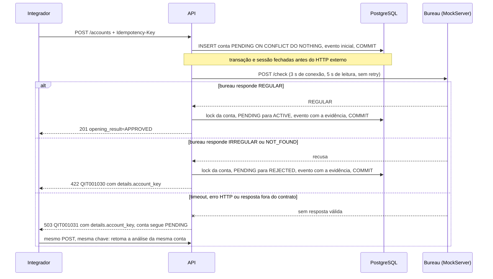

1. Arbitrar a Idempotency-Key e gravar a conta PENDING (saldo zero, versão 1) com o evento
   inicial, numa transação curta já confirmada.
2. Fechar transação e sessão antes do HTTP e consultar o bureau. Dívida informada pelo bureau é
   só registrada: o produto não oferece crédito, então ela não recusa a abertura.
3. Abrir outra transação, travar a conta com `FOR NO KEY UPDATE` e reler: só uma conta ainda
   PENDING recebe a conclusão. Se outra tentativa concluiu antes, a resposta tardia é descartada e
   vale a decisão gravada.
4. Estado, versão e evento com a evidência do bureau entram no mesmo COMMIT. Na falha do bureau
   nada muda no banco: a conta existente é reaproveitada no reenvio, e sem reenvio ela continua
   PENDING, porque não há fila nem worker.

**Estados da conta e bloqueio: caminho feliz**

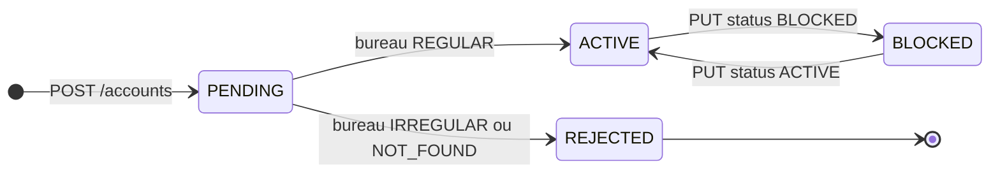

| Estado | O que a conta pode fazer | Como sai dele |
|---|---|---|
| PENDING | Só consulta; saldo zero. | Decisão do bureau: ACTIVE ou REJECTED. |
| ACTIVE | Debita e recebe. | BLOCKED, por comando do integrador. |
| BLOCKED | Recebe crédito, inclusive aporte; não debita. | ACTIVE, por comando do integrador. |
| REJECTED | Só consulta; saldo zero. | Não sai: é terminal para aquela abertura. |

1. Travar a conta com `FOR NO KEY UPDATE` e reler estado e `status_version`; só ACTIVE e BLOCKED
   aceitam o comando, e não há rota que force a aprovação de PENDING ou reabra REJECTED.
2. Versão esperada igual à atual: mudar o estado, incrementar a versão e gravar o evento no mesmo
   COMMIT (`200`). Se o estado já é o pedido, `200` sem novo evento.
3. Versão atual igual à esperada mais um, com o último evento feito pelo integrador e de mesmo
   destino e motivo: é o reenvio da última transição, que devolve o mesmo resultado.

**Bloqueio de conta, falha: versão obsoleta**

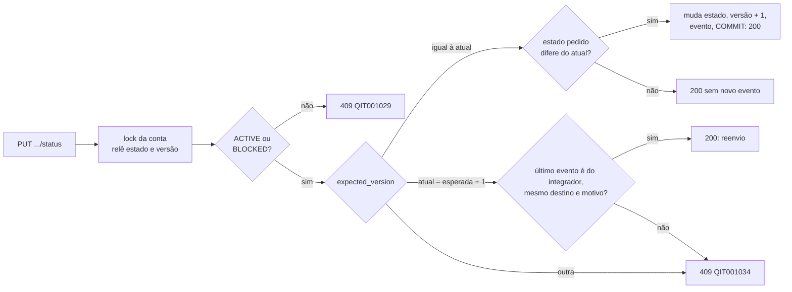

1. Qualquer outra versão recebe `409` QIT001034, e nada muda. Por isso um bloqueio antigo,
   reenviado depois de um desbloqueio, não volta a valer.
2. A decisão do bureau não é um comando: um PUT com a versão anterior a ela também recebe `409`,
   mesmo que o motivo coincida.
3. Bloqueio e débito disputam o mesmo lock da conta. Se o bloqueio confirma primeiro, a
   transferência relê BLOCKED e recusa com `409` QIT001029; se o débito confirma primeiro, ele vale,
   e o bloqueio passa a valer para as operações seguintes.

**Transferência: caminho feliz**

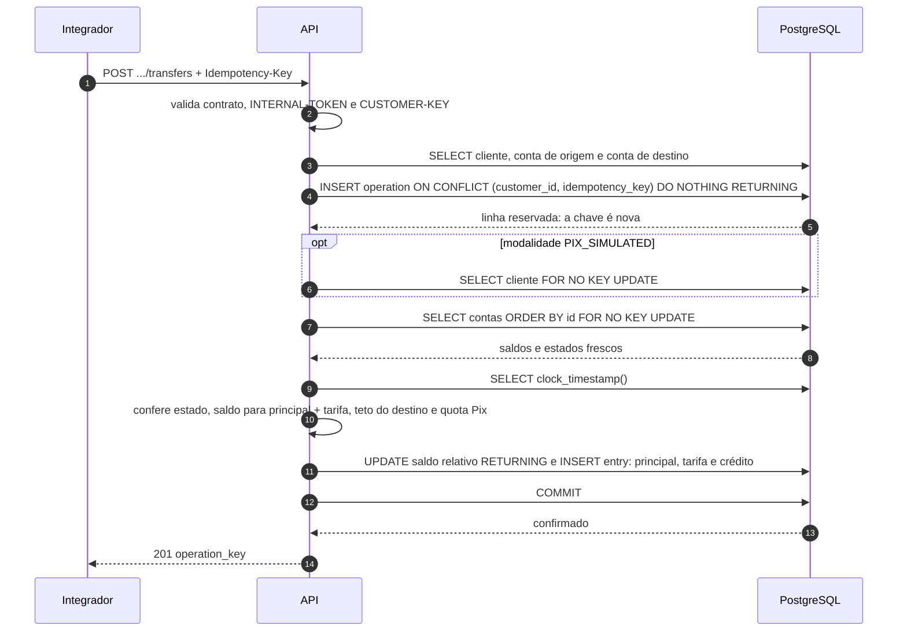

1. Validar o contrato, o INTERNAL-TOKEN e a CUSTOMER-KEY; autorizar a conta de origem; resolver
   o destino e recusar origem igual ao destino.
2. Reservar a intenção: `INSERT` da operação com
   `ON CONFLICT (customer_id, idempotency_key) DO NOTHING RETURNING`, na mesma transação do débito.
3. No Pix, travar a linha do cliente; depois, origem e destino com `FOR NO KEY UPDATE`, sempre por
   id crescente, e reler saldo e estado. A ordem fixa impede deadlock entre A→B e B→A.
4. Ler `clock_timestamp()` uma vez, já com os locks, e conferir estado, saldo para principal mais
   tarifa, teto do destino e, no Pix, a quota da janela de São Paulo.
5. `UPDATE` relativo com `RETURNING` em cada conta e um lançamento por efeito: principal e tarifa
   na origem, principal no destino. Tarifa zero não gera lançamento.
6. Um único `COMMIT` confirma operação, lançamentos e saldos; só então a API responde `201` com
   `operation_key`. O aporte segue o mesmo caminho, sem origem nem tarifa.

**Aporte, falha: sandbox desligado**

1. A reserva da chave vem antes da checagem do sandbox. O reenvio de um aporte já confirmado
   devolve `201` com a operação original, e a mesma chave com outro valor devolve `409` QIT001012.
2. Só o aporte novo chega à checagem: `403` QIT001035 e rollback, sem lançamento nem saldo.

**Transferência, falha: dois débitos concorrentes sem saldo para ambos**

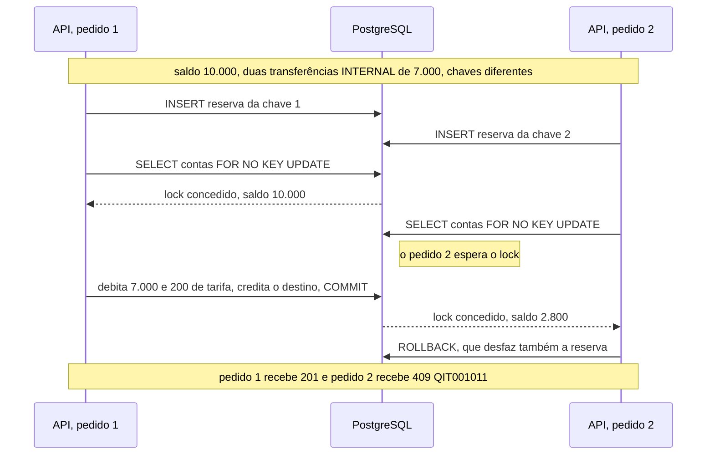

1. As duas reservam suas chaves, que não conflitam. A primeira obtém o lock da origem; a segunda
   espera no `FOR NO KEY UPDATE`.
2. A primeira debita principal e tarifa, confirma e libera o lock. A segunda relê o saldo
   restante (2.800, para PF) e recusa.
3. A recusa desfaz a transação inteira, inclusive a reserva: não sobra operação nem lançamento, e
   a mesma chave pode ser reavaliada depois, quando houver saldo.

**Transferência, falha: confirmação do COMMIT perdida**

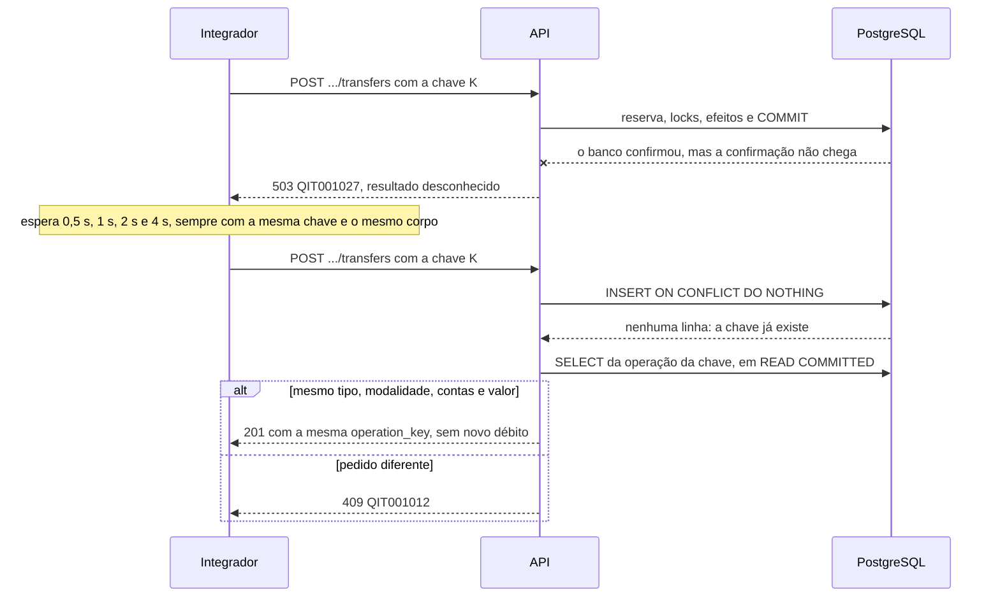

1. A API não presume rollback: responde `503` QIT001027 e registra o resultado como desconhecido.
2. O cliente reenvia a mesma chave e o mesmo corpo, sem nunca trocar a chave da intenção.
3. O `INSERT ... ON CONFLICT` encontra a operação confirmada; um `SELECT` separado em READ
   COMMITTED a lê e compara tipo, modalidade, contas e valor. A tarifa não entra na comparação: é
   calculada pelo servidor e preservada como foi gravada.
4. Igual: `201` com a mesma `operation_key`, sem novo débito, tarifa ou consumo de quota, mesmo
   que a conta tenha sido bloqueada depois. Se o COMMIT não tinha acontecido, o reenvio executa a
   transferência pela primeira vez.

**Pix simulado, falha: quota da janela esgotada**

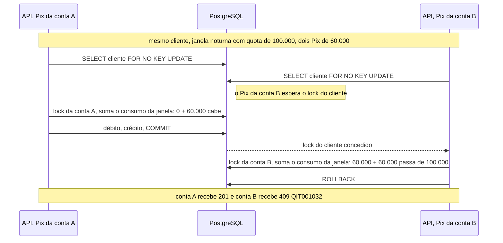

1. O Pix trava primeiro a linha do cliente. Assim duas contas do mesmo cliente não consomem a
   mesma quota ao mesmo tempo: o segundo pedido só soma o consumo depois que o primeiro termina.
2. Com o instante lido após os locks, a API localiza a janela em America/Sao_Paulo. Uma operação
   à 01:00 pertence à janela que começou às 20:00 do dia anterior.
3. O consumo é a soma dos débitos de principal já confirmados na janela. Se ele mais o valor
   pedido passa da quota, `409` QIT001032 e rollback. Tarifa, recebimento e INTERNAL não consomem.

**Extrato: caminho feliz e falha com cursor inválido**

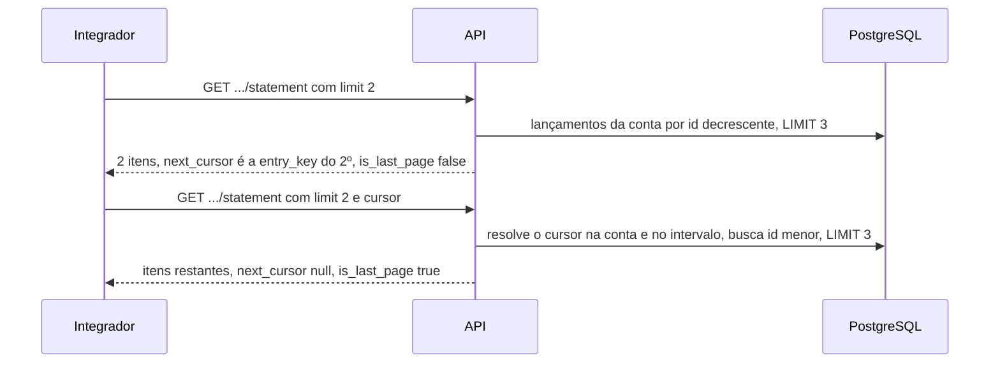

1. Validar os parâmetros e o `limit`, autorizar a conta e validar datas e cursor. Sem cursor, a
   leitura começa pelos lançamentos mais recentes.
2. Buscar um item além do `limit`: ele só indica que há próxima página. O `next_cursor` é a
   `entry_key` do último item devolvido.
3. Os ids dos lançamentos nascem sob o lock da conta, então a ordem por id é a ordem dos fatos
   daquela conta. Lançamento novo entra antes da primeira página e não desloca as seguintes.
4. Cursor malformado, de outra conta ou fora do intervalo de datas recebe `400` QIT001033, com a
   mesma resposta nos três casos, para não revelar de quem ele é.

**Detalhe da operação: caminho feliz e falha com operação sem lançamento na conta**

1. Autorizar a conta do caminho e buscar os lançamentos da operação só naquela conta, em ordem
   crescente. A resposta traz `operation_key`, `type`, `modality`, `created_at` e as `entries`.
2. Cada lado vê apenas o que aconteceu na sua conta, e nunca o saldo, a tarifa ou o cadastro da
   contraparte:

| Quem consulta | Lançamentos que vê | O que não vê |
|---|---|---|
| Titular da origem | `TRANSFER_DEBIT` do principal e, se houve tarifa, `FEE_DEBIT`, cada um com o seu `balance_after_cents`. | Saldo e lançamentos do destino. |
| Titular do destino | `TRANSFER_CREDIT` do principal, com o seu `balance_after_cents`. | Tarifa paga, saldo da origem e chave de idempotência. |
| Titular de um aporte | `DEPOSIT_CREDIT`. | Não há contraparte. |

3. Operação inexistente e operação que não tem lançamento naquela conta recebem a mesma resposta:
   `404` QIT001028. O destinatário pode consultar o crédito que recebeu mesmo sem ter pedido a
   operação, desde que use a própria conta no caminho.

> **Principal desafio**
>
> - **Qual é:** fazer cada intenção financeira produzir exatamente um efeito (nenhum débito
>   duplicado, saldo nunca negativo, extrato que reconstrói o saldo) com requisições concorrentes,
>   reenvios e respostas perdidas.
> - **Por que é difícil:** a solução óbvia, "procurar a chave, ler o saldo, debitar", quebra em três
>   cenários: dois débitos de chaves diferentes leem o mesmo saldo de 10.000 e debitam 7.000 cada;
>   o mesmo pedido reenviado após timeout passa pela consulta antes que o primeiro confirme; e um
>   503 depois do COMMIT não prova que nada aconteceu.
> - **Como o desenho resolve:** `INSERT ... ON CONFLICT (customer_id, idempotency_key) DO NOTHING`
>   arbitra a repetição no banco, e um `SELECT` separado em READ COMMITTED devolve o replay;
>   `FOR NO KEY UPDATE` nas contas por id crescente (no Pix, depois do lock do cliente) serializa
>   saldo, estado e quota; `UPDATE` relativo com `RETURNING` e os lançamentos entram no mesmo
>   `COMMIT`; confirmação perdida vira 503/QIT001027 e se recupera reenviando a mesma chave.
