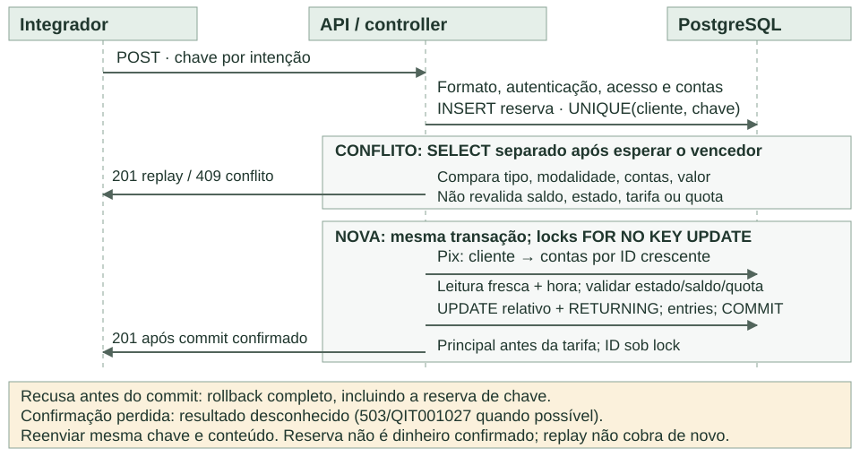

# Especificação detalhada: protótipo bancário com saldo e extrato consistentes

**Bootcamp QI Tech · Projeto bancário · complemento da RFC v8 · 12/10/2026**  
A [RFC v8](RFC-v8.md) apresenta o desenho no modelo do bootcamp, em dez páginas, com os diagramas dos fluxos. Este
documento detalha as regras, os dicionários de dados, o catálogo de erros, a estratégia de testes e
a operação que não cabem nela; o diagrama do modelo e o principal desafio ficam na RFC.

## 1. Contexto, problema e objetivos

Protótipo bancário do bootcamp QI Tech para cadastrar PF/PJ, abrir contas, receber aportes de sandbox, transferir valores com tarifas e consultar saldo/extrato. O problema central é preservar dinheiro e histórico diante de concorrência, repetição e perda de resposta: um único commit confirma operação, lançamentos e saldos, sem débito parcial, duplicado ou negativo.

**Escopo:** integrador confiável, titular único com múltiplas contas, BRL, bureau mockado, estados de conta, transferências internas e Pix simulado, tarifas e quota por cliente. As funcionalidades centrais e a entrega Linux/Compose/pytest seguem o curso; os detalhamentos são decisões aprovadas da equipe.

**Limites:** dados fictícios; sem liquidação externa, SPI/DICT, chaves Pix reais, crédito, conta conjunta, estorno, encerramento, câmbio, frontend bancário, login próprio ou múltiplos integradores. O histórico deve reconstruir saldos e restringir consultas ao titular. O desenho não constitui contabilidade institucional completa nem comprova conformidade com Pix real. Os testes descritos são critérios para a implementação.

## 2. Arquitetura e responsabilidades

Monólito modular: Python 3.11, FastAPI, SQLAlchemy 2.0, psycopg2 e PostgreSQL 16, com versões fixadas conforme a base e handlers síncronos. Cliente, conta, tarifa e lançamentos compartilham uma fronteira de commit; microsserviços acrescentariam coordenação distribuída sem necessidade de autonomia neste escopo.

**Camadas:** resource/schema adapta HTTP e valida formato, sem SQL de negócio; controller autoriza, aplica regras e controla locks/commit/rollback; repository/model consulta e escreve as cinco entidades, sem commit próprio; DTO limita a saída; middleware cuida do contexto, request_id, logs e encerramento da sessão; connector encapsula transporte/timeout do bureau, cuja decisão cabe ao controller.

Módulos customers, accounts, operations, status e health usam resources/, schemas/, controllers/, repositories/, models/, dtos/, connectors/ e middlewares/; testes em tests/ e schema em database.sql. api-fee0 é a mesma imagem com tarifas zeradas para testes; MockServer simula o externo. Sem fila ou worker: abertura pendente é retomada pelo consumidor.

## 3. Clientes, identidade e autorização

### Cadastro PF/PJ e documentos

Cada cliente possui customer_key UUID, customer_type PF ou PJ, nome civil/razão social não vazio até 120 caracteres, document_number textual e email opcional até 254 caracteres. Nome é aparado nas extremidades; email omitido e null têm a mesma representação. O pedido normalizado é preservado para comparação idempotente; não há edição cadastral nesta versão.

CPF possui 11 dígitos; CNPJ possui 14 posições, aceitando o formato numérico e o alfanumérico. A normalização remove somente a pontuação admitida, preserva zeros e converte letras do CNPJ para maiúsculas. O validador confere formato e dígitos verificadores segundo o algoritmo aplicável, sem transformar documento em inteiro. CNPJ alfanumérico tem letras/números nas primeiras 12 posições e dois verificadores numéricos ([Receita Federal](https://www.gov.br/receitafederal/pt-br/acesso-a-informacao/acoes-e-programas/programas-e-atividades/cnpj-alfanumerico)).

O par (customer_type, document_number) é único. Um mesmo cliente pode ter várias contas; cada conta pertence a exatamente um titular. Essa escolha permite exercitar autorização e limites compartilhados sem implementar conta conjunta. Incluir PF/PJ exige testes de ambos os validadores e das quatro combinações de tarifa, mantendo o restante do modelo comum.

### Fronteira de confiança

O protótipo reconhece um único integrador de backend por INTERNAL-TOKEN. Após o cadastro, esse integrador envia CUSTOMER-KEY como contexto de cliente. A identidade fixa do integrador vem da configuração associada ao token, nunca de um identificador livre enviado no corpo. CUSTOMER-KEY é uma declaração autenticada do integrador; um UUID conhecido isoladamente não autentica ninguém.

O integrador autentica seus usuários, verifica a representação de empresas e restringe o acesso às ações administrativas. A API confere, a cada pedido, cliente–conta e conta–operação. Essa divisão evita duplicar o ciclo de login/credencial pessoal; não haverá CUSTOMER-TOKEN, emissão de segredo por cliente nem access_token_hash no cadastro.

A consequência é explícita: comprometer o integrador permite declarar identidades sob sua confiança. INTERNAL-TOKEN fica somente no backend, fora de navegador, repositório e logs. Comunicação publicada usa HTTPS. O monitoramento possui MONITORING-TOKEN separado, aceito apenas na readiness e incapaz de autorizar operações financeiras.

### Isolamento nas consultas e nos comandos

- Cadastro inicial exige INTERNAL-TOKEN e Idempotency-Key, sem CUSTOMER-KEY de um cliente que ainda não existe.
- Nas demais rotas de negócio, o contexto é obrigatório. UUID de cliente na rota ou corpo deve coincidir com o contexto autenticado.
- Conta inexistente e conta de outro titular retornam o mesmo 404. O detalhe exige também que exista lançamento da operação naquela conta.
- O destinatário pode consultar seu próprio crédito mesmo sem ter solicitado a operação. A resposta exclui tarifa, saldo e lançamentos da contraparte.
- Destino de transferência pode pertencer a outro cliente. Resolver o destino não autoriza divulgar seu cadastro ou estado detalhado.

**Alternativa descartada:** token pessoal por correntista acrescentaria emissão, entrega única, recuperação e rotação. Com um integrador já responsável pela identidade, esse ciclo criaria novos riscos sem retirar a confiança nele. Autenticação direta de usuários e múltiplos parceiros exigiriam revisão dessa fronteira.

## 4. Criação idempotente e bureau simulado

POST /customers e POST /accounts exigem Idempotency-Key UUID. A unicidade é por integrador e comando: customer e account mantêm separadamente UNIQUE(creation_integrator, creation_idempotency_key). Cada recurso guarda o pedido original normalizado em creation_request. A chave acompanha o recurso; não há expiração automática ou necessidade de cache externo de respostas.

### Cadastro e recuperação

O cadastro valida CPF/CNPJ e arbitra a chave no banco. Mesmo pedido e chave devolvem o customer_key original; mesma chave e pedido válido diferente retornam 409. Uma chave nova com documento já cadastrado também retorna 409, sem criar outro cliente. Como o sucesso devolve somente o identificador, não há segredo a reemitir quando a resposta se perde.

### Abertura: caminho completo

1. Autenticar o integrador, autorizar o cliente e normalizar o pedido. Arbitrar a chave de criação. Se já existe conta para a chave, comparar o pedido; conflito retorna 409.
2. Na primeira execução, persistir conta com saldo zero, PENDING e status_version=1, junto do evento inicial e metadados de criação. Confirmar essa transação curta.
3. Encerrar transação e sessão de banco antes do HTTP. Se a abertura já foi concluída, recuperar seu resultado original sem consultar o bureau novamente.
4. Para a conta ainda PENDING, o connector consulta o documento no MockServer, com conexão de 3 s e leitura de 5 s, sem retry interno. O contrato distingue REGULAR, IRREGULAR, NOT_FOUND e falha técnica; inadimplência é indicador separado.
5. Abrir nova transação, obter FOR NO KEY UPDATE da conta e reler estado. Somente PENDING pode receber a conclusão. REGULAR produz ACTIVE; IRREGULAR/NOT_FOUND produz REJECTED. Gravar estado, versão, evento e evidência mínima no mesmo commit.
6. Se outro concorrente já concluiu, descartar a resposta tardia e devolver o resultado persistido. Se o connector falhou, também reconsultar o estado sob coordenação antes de informar pendência; uma conclusão concorrente prevalece.
7. Após commit confirmado, aprovação retorna 201 com account_key e opening_result=APPROVED. Recusa retorna 422/QIT001030 com details.account_key próprio. Falha técnica, permanecendo PENDING, retorna 503/QIT001031.

Guardar somente classificação/motivo, referência, instante e indicador de inadimplência necessários para explicar a decisão. Documento matematicamente válido, situação cadastral, identidade do usuário e titularidade externa são verificações diferentes. A consulta simulada não autentica pessoas nem verifica uma conta em outra instituição.

### Motivação e consequência

Escolhemos bureau simulado para demonstrar connector, contrato externo e falhas determinísticas sem contratar um serviço real ou usar dados pessoais. Inadimplência é informativa, pois o produto não oferece crédito. Recusar cadastro por dívida acrescentaria uma regra sem fundamento no escopo.

A pendência é estado do recurso, não uma operação financeira incompleta. Reenviar o mesmo POST/chave retoma a análise; GET apenas consulta. Sem reenvio, a conta pode continuar PENDING. Aceitamos esse limite para evitar fila e worker. Duas chamadas externas de leitura podem acontecer em paralelo; apenas uma conclusão local é aplicada. Commit de qualquer etapa sem confirmação confiável exige recuperar pela mesma chave.

## 5. Estados e concorrência administrativa

| Estado | Uso permitido | Transições |
| --- | --- | --- |
| PENDING | Consultar; saldo zero; abertura em análise. | ACTIVE ou REJECTED por avaliação cadastral. |
| ACTIVE | Consultar, receber crédito e debitar, respeitando as regras financeiras. | BLOCKED por comando administrativo. |
| REJECTED | Consultar o registro da abertura recusada; saldo zero. | Terminal para esta solicitação. |
| BLOCKED | Consultar e receber créditos; novos débitos recusados. | ACTIVE por comando administrativo. |

A conta começa em PENDING, acompanhada do evento inicial. Saldo insuficiente recusa somente a movimentação: não bloqueia conta nem cria evento de estado. O bloqueio representa uma restrição administrativa de saída; receber crédito pode ajudar a recompor saldo e não contraria essa restrição. Aporte próprio é um crédito e segue a mesma regra, se o sandbox estiver habilitado.

### Comando de bloqueio e desbloqueio

PUT /accounts/{account_key}/status exige INTERNAL-TOKEN, CUSTOMER-KEY, status ACTIVE ou BLOCKED, reason com ao menos um caractere visível e até 240 caracteres (gravado como enviado, sem aparar) e expected_version inteiro positivo. O integrador limita quem pode emitir o comando em sua plataforma; a API verifica titularidade e protege a concorrência. Não há rota para forçar a aprovação de PENDING nem reabrir REJECTED.

1. Bloquear a linha da conta com FOR NO KEY UPDATE e reler estado/status_version. Validar que o estado atual permite a ação.
2. Se expected_version corresponde à versão atual e há mudança de estado, incrementar a versão e inserir account_status_event com anterior, novo, motivo, ator e instante. Confirmar os dois efeitos juntos.
3. Se o estado já é o solicitado e a versão esperada é a atual, retornar sucesso sem novo evento.
4. Um reenvio da última transição é reconhecido se a versão atual é expected_version+1 e o último evento possui o mesmo destino e motivo. Retornar o resultado sem duplicar histórico.
5. Qualquer outra versão obsoleta retorna 409/QIT001034, sem mudar estado. Um bloqueio antigo não pode reaplicar-se após um desbloqueio posterior.

### O que acontece quando bloqueio e débito concorrem

Ambos coordenam pela mesma linha da conta. Se o bloqueio confirma primeiro, a movimentação relê BLOCKED e recusa o novo débito. Se a movimentação adquire o lock e confirma primeiro, o débito é válido no estado que observou; o bloqueio passa a valer para operações posteriores. Não existe garantia de prioridade pela ordem de chegada das requisições HTTP.

Replay financeiro já confirmado continua retornando o resultado original mesmo depois de um bloqueio. Essa resposta não executa um débito novo. De modo semelhante, replay da abertura recupera o resultado imutável do evento que saiu de PENDING; não usa BLOCKED como se fosse recusa da abertura. GET /accounts/{account_key} fornece o estado atual.

**Por que versionar:** somente conferir o estado desejado evita algumas duplicações, mas não distingue uma tentativa antiga de uma decisão nova após mudanças intermediárias. A versão oferece essa distinção com um campo e o histórico já necessário, sem tabela genérica de comandos ou coordenação externa.

## 6. Dinheiro, tarifas e limite Pix

Toda conta inicia em zero. Aporte próprio simulado fornece o saldo de demonstração somente com `SANDBOX_DEPOSITS=true`; a conta deve ser do cliente autenticado. O código assume desligado quando a variável falta, mas o Compose de avaliação e o `.env.example` a ligam por padrão. Desligado, um aporte novo recebe 403/QIT001035 depois da arbitragem da chave: o reenvio de um aporte já confirmado continua devolvendo 201, e a mesma chave com outro pedido continua em 409/QIT001012. Para enviar a terceiros, o consumidor usa transferência. Não há lastro externo verificado nem depósito por pessoa não autorizada.

| Modalidade | PF | PJ |
| --- | --- | --- |
| INTERNAL | 200 (R$ 2,00) | 500 (R$ 5,00) |
| PIX_SIMULATED | 0 | 100 (R$ 1,00) |
| Aporte próprio de sandbox | 0 | 0 |

A tarifa depende do tipo do titular da origem e da modalidade, é calculada pelo servidor e fica persistida em operation.fee_cents. Principal e tarifa precisam caber no saldo disponível. O destinatário recebe apenas o principal. Tarifa zero não cria entry de delta zero. Configurações são validadas no startup; alterações afetam somente novas operações. Replay mantém a tarifa registrada, inclusive quando atendido por api-fee0.

### Representação e teto

Valores usam BIGINT em centavos de BRL. Principal varia de 1 a 2^53−1; saldos e tarifas, de zero a esse teto. JSON monetário aceita apenas inteiros, rejeitando strings, booleanos e floats antes de qualquer conversão. O teto atende consumidores que usam números JSON/JavaScript ([RFC 8259, §6](https://www.rfc-editor.org/rfc/rfc8259#section-6)). Calcular principal+tarifa sem overflow e conferir o crédito contra o teto do destino.

Inteiros evitam erro binário de ponto flutuante e dispensam política de arredondamento nesta escala fixa. NUMERIC/Decimal seria adequado a juros, câmbio ou escalas variáveis, que estão fora do recorte. O teto de representação não é uma estimativa de volume financeiro do sistema.

### Pix local e quota acumulada

| Janela em America/Sao_Paulo | Principal enviado por cliente |
| --- | --- |
| 06:00 inclusive até 20:00 exclusive | 1.000.000 centavos (R$ 10.000,00) |
| 20:00 inclusive até 06:00 do dia seguinte exclusive | 100.000 centavos (R$ 1.000,00) |

PIX_SIMULATED é transferência entre contas existentes no mesmo banco, identificada por modality. Reutiliza locks, lançamentos e commit de INTERNAL. Não consulta chave Pix real nem produz efeito em outra instituição. Diferenciar modalidade permite demonstrar regras próprias sem distribuir a escrita financeira.

O limite é por cliente PF/PJ e soma todas as suas contas, inclusive Pix entre contas distintas do próprio titular. Só o principal enviado consome quota; tarifa exige saldo, mas não quota. Recebimentos não recompõem quota e INTERNAL não a consome. Não há teto adicional por operação além de saldo, representação e quota disponível.

O período noturno atravessa a meia-noite: uma operação às 01:00 pertence à janela iniciada às 20:00 do dia anterior. Usar America/Sao_Paulo para obter as bordas locais e convertê-las a UTC. O instante financeiro é obtido no servidor após os locks. Quota é a soma dos débitos principais confirmados nessa janela; recusa, tarifa, crédito e replay não geram consumo adicional.

## 7. Modelo de dados e relações

O diagrama das cinco entidades, com chaves e cardinalidades, está na [RFC, seção Banco de Dados](RFC-v8.md#banco-de-dados-somente-diagrama); `database/database.sql` é a fonte de verdade das colunas e restrições.

O modelo separa identidade, estado operacional, intenção financeira confirmada e efeito no saldo. customer possui 0..N contas e solicita 0..N operações. account possui um titular, 1..N eventos de estado e 0..N lançamentos. operation possui um destino e origem apenas em transferência; cada lançamento pertence a uma conta e a uma operação.

Uma operação de aporte produz um lançamento; transferência sem tarifa produz dois; com tarifa positiva, três. A origem pode observar principal e tarifa, e o destino apenas seu crédito. Essa quantidade e a correspondência de valores são regras transacionais, não consequência automática das FKs.

IDs BIGINT servem ao banco e à ordenação. UUIDs públicos identificam recursos nos contratos sem expor a sequência interna. UUID não substitui autorização. Todas as FKs usam ON DELETE RESTRICT; não há DELETE de negócio. Instantes persistidos são TIMESTAMPTZ, serializados em UTC.

**Por que saldo materializado e lançamentos:** ler saldo direto simplifica as consultas; o histórico permite explicar e reconciliar cada alteração. Somar todo o histórico em cada consulta reduziria uma redundância, mas aumentaria custo e não eliminaria a necessidade de coordenar débitos. O preço da escolha é obrigar toda escrita a atualizar saldo e histórico na mesma transação.

## 8. Dicionário: cliente, conta e estados

### customer

| Atributo | Regra |
| --- | --- |
| id / customer_key | BIGINT interno / UUID público UNIQUE |
| customer_type / document_number | PF ou PJ; VARCHAR(14) normalizado; UNIQUE(tipo, documento) |
| name / email | Nome civil ou razão social até 120; email opcional até 254 |
| creation_integrator / creation_idempotency_key | Identidade do integrador autenticado; UUID. UNIQUE(integrador, chave) nesta tabela. |
| creation_request | JSONB imutável com tipo, documento, nome e email normalizados para comparar o cadastro; sem credenciais. |
| created_at | TIMESTAMPTZ; não há access_token_hash |

### account

| Atributo | Regra |
| --- | --- |
| id / account_key / customer_id | BIGINT / UUID UNIQUE / FK customer NOT NULL |
| balance_cents | BIGINT entre 0 e 2^53−1; PENDING/REJECTED exigem zero |
| status / status_version | PENDING, ACTIVE, REJECTED ou BLOCKED; versão inteira positiva inicia em 1 |
| creation_integrator / creation_idempotency_key | UNIQUE(integrador, chave) nesta tabela; namespace distinto do cadastro de cliente |
| creation_request / created_at | JSONB imutável com customer_key normalizado; TIMESTAMPTZ de criação |

### account_status_event

| Atributo | Regra |
| --- | --- |
| id / event_key / account_id | BIGINT / UUID UNIQUE / FK account |
| version / previous_status / new_status | UNIQUE(account_id, version); previous_status NULL somente na criação; versão nova coincide com account.status_version |
| reason / actor / created_at | Motivo até 240; integrador ou avaliação cadastral; instante da mudança |
| bureau_reference / bureau_checked_at / has_debt | Opcionais, presentes somente na conclusão cadastral; motivo distingue REGULAR, IRREGULAR e NOT_FOUND. Sem resposta bruta. |

Apenas campos explicitamente opcionais admitem NULL. creation_request contém entradas de negócio normalizadas, nunca credenciais. Ator administrativo identifica o integrador; ator cadastral identifica o fluxo de avaliação. O motivo de conclusão distingue REGULAR, IRREGULAR e NOT_FOUND. Evidências externas ficam no evento de conclusão; o estado atual continua em account.

Não é necessário duplicar opening_result em account: a transição imutável de PENDING determina aprovação/recusa inicial. A versão do evento coincide com status_version aplicado; a criação gera versão 1, com previous_status NULL. A leitura do último evento explica o estado atual.

## 9. Dicionário financeiro e integridade

### operation

| Atributo | Regra |
| --- | --- |
| id / operation_key / customer_id | BIGINT / UUID UNIQUE / FK cliente autor |
| type / modality | DEPOSIT com modality NULL; TRANSFER com INTERNAL ou PIX_SIMULATED |
| origin_account_id / destination_account_id | FK origem NULL somente em aporte; destino obrigatório. Na transferência, contas distintas. |
| amount_cents / fee_cents | BIGINT: principal 1..2^53−1, tarifa 0..2^53−1; depósito com tarifa zero |
| idempotency_key / created_at | UUID; UNIQUE(customer_id, idempotency_key); TIMESTAMPTZ pós-lock. Valores e modalidade imutáveis no commit. |

### account_entry

| Atributo | Regra |
| --- | --- |
| id / entry_key / operation_id / account_id | BIGINT / UUID UNIQUE / FKs obrigatórias |
| role / delta_cents | DEPOSIT_CREDIT e TRANSFER_CREDIT positivos; TRANSFER_DEBIT e FEE_DEBIT negativos; delta nunca zero |
| balance_after_cents / created_at | Saldo retornado por UPDATE; instante único da operação |
| UNIQUE(operation_id, role) | 1 entry no aporte; 2 na transferência sem tarifa ou 3 com tarifa. IDs sequenciais CACHE 1 obtidos sob lock. |

operation.customer_id identifica o solicitante: titular da origem na transferência e do destino no aporte. A identidade do destinatário não substitui a do solicitante.

### Invariantes que devem permanecer verdadeiras

- Saldo atual da conta = soma de todos os seus delta_cents confirmados. Em cada entry, balance_after_cents corresponde ao saldo após aquele delta.
- Para cada transferência: débito principal = −amount_cents; crédito de destino = amount_cents; tarifa, quando positiva, = −fee_cents na origem.
- Soma de todos os saldos + tarifas confirmadas = aportes confirmados. A tarifa é saída deste sublivro; não há conta institucional de receitas nesta versão.
- PENDING e REJECTED sempre têm saldo zero. Estado e evento/versionamento mudam juntos; nenhum lançamento existe para uma operação financeira recusada.

PK, UUIDs únicos, FKs, NOT NULL e CHECKs protegem tipo/modalidade, sinal por role, valores e tetos locais. UNIQUE(operation_id, role) evita duplicar um papel na mesma operação. CHECKs não comprovam somas entre tabelas: controller e testes devem garantir quantidade, contas corretas e igualdade entre principal, tarifa e deltas.

Índices iniciais: account(customer_id,id), account_entry(account_id,id DESC), operation(customer_id,modality,created_at), além de índices únicos e das referências usadas nos joins. Revisar planos no volume de teste antes de acrescentar índices. Não há tabela de quota nem cache de saldo: dados financeiros confirmados são a fonte do consumo.

## 10. Escrita monetária: ordem obrigatória

1. **Entrada e acesso.** Validar schema estrito, autenticar integrador/contexto e autorizar conta da rota. Resolver o destino; recusar origem igual ao destino. Estado e saldo não são usados para rejeitar um replay já confirmado.
2. **Reserva imediata.** Na mesma transação financeira, executar INSERT de operation com ON CONFLICT (customer_id,idempotency_key) DO NOTHING RETURNING. Registrar tipo, modalidade, contas, valor e tarifa inicial. session.add() sem flush não arbitra a chave.
3. **Conflito.** Após eventual espera, fazer SELECT separado em READ COMMITTED. Comparar tipo, modalidade, origem, destino e valor. Igual recupera operation_key/201; diferente retorna 409. Se a tentativa concorrente abortou, o INSERT pode prosseguir.
4. **Operação nova.** Para Pix, coordenar primeiro a linha do cliente de origem; depois travar todas as contas por ID crescente com FOR NO KEY UPDATE. Reler saldos e estados frescos.
5. **Regras e instante.** Obter clock_timestamp() uma vez após todos os locks e atualizar o instante provisório da reserva. Conferir, nesta ordem, sandbox habilitado (só no aporte), estados, principal+tarifa, teto do destino e quota Pix.
6. **Efeitos.** UPDATE relativo + RETURNING para cada delta e INSERT da entry com o saldo retornado; em seguida o controller confere esse saldo contra o esperado e, se divergir, aborta a transação com 500/QIT000500. Na origem, principal antes da tarifa; destino recebe principal. IDs nascem nos INSERTs sob lock.
7. **Conclusão.** Flush explícito, montar DTO simples e confirmar um único COMMIT. Responder 201 apenas depois da confirmação. Não reler ORM expirado para construir a resposta nem deixar saldo absoluto antigo sobrescrever a escrita relativa.

A garantia depende da combinação e da ordem dos mecanismos: unicidade arbitra repetição; locks coordenam regras; atualização relativa e lançamentos no mesmo commit preservam dinheiro. Aplicar apenas um desses mecanismos não protege todos os cenários; o principal desafio está descrito na RFC, em Fluxos.

## 11. Concorrência, locks e ordenação

### Saldo e quota sob a mesma coordenação

Dois débitos com chaves diferentes podem ser válidos isoladamente e exceder o saldo em conjunto. Por isso, a decisão usa valores relidos após o lock. Em Pix, duas contas do mesmo cliente também podem competir pela mesma quota: a linha do cliente é coordenada antes das contas. O segundo pedido só apura consumo depois que o primeiro termina. A reserva atual ainda não tem entries e não entra na soma.

Todos os caminhos que precisam de cliente e contas seguem cliente antes de contas; contas sempre em ID crescente, inclusive quando o sentido econômico da transferência é inverso. Aporte trava só o destino; comando de estado trava só sua conta; INTERNAL trava origem/destino. Nenhum desses caminhos adquire depois um lock de cliente que viole a ordem.

### Por que FOR NO KEY UPDATE e READ COMMITTED

A reserva possui FKs para cliente e contas. A verificação dessas referências pode adquirir KEY SHARE. FOR NO KEY UPDATE é compatível com esse modo e ainda serializa as atualizações de saldo/estado que não alteram chaves. Trocar isoladamente por FOR UPDATE introduziria conflitos desnecessários entre referências e bloqueios de linhas ([PostgreSQL: locks](https://www.postgresql.org/docs/16/explicit-locking.html)). Não atualizamos PKs ou chaves referenciadas.

READ COMMITTED fornece um novo snapshot por comando. Por isso, após ON CONFLICT aguardar uma transação concorrente, o SELECT separado pode recuperar o resultado que acabou de confirmar. Não concentrar arbitragem e leitura de fallback no mesmo snapshot de uma única expressão ([PostgreSQL: isolamento](https://www.postgresql.org/docs/16/transaction-iso.html)). A unicidade continua sendo a autoridade; consultar antes e inserir depois deixa uma janela de corrida.

SERIALIZABLE foi considerado, mas adicionaria abortos de serialização e tratamento de reexecução em mais caminhos. Para os recursos conhecidos desta versão, locks explícitos e ordem uniforme tornam o raciocínio e os testes mais diretos. Isso não autoriza escrituras fora do protocolo nem promete ausência de deadlocks em qualquer SQL futuro.

### Leitura fresca, IDs e tempo

A identidade de uma entidade no cache ORM não garante que seus atributos reflitam o banco após esperar um lock. Usar projeções frescas ou populate_existing. O saldo é atualizado com delta relativo e RETURNING; não manter uma alteração absoluta pendente no objeto ORM. O valor retornado alimenta balance_after_cents.

IDs de entries são atribuídos pelo INSERT enquanto os locks estão mantidos, com sequência CACHE 1 e sem pré-alocação. Isso permite ordenar os lançamentos de uma conta; não promete ordem global de commit entre contas independentes. Lacunas por rollback são normais e não representam lançamentos ausentes ([PostgreSQL: sequências](https://www.postgresql.org/docs/16/sql-createsequence.html)).

Todos os lançamentos de uma operação recebem o mesmo instante financeiro obtido após os locks. now() representa o início da transação e pode ficar anterior a uma espera longa; clock_timestamp() fornece a leitura escolhida ([PostgreSQL: relógios](https://www.postgresql.org/docs/16/functions-datetime.html)). Timestamp não é chave de ordenação do extrato nem garantia de monotonicidade do relógio.

### Exemplos de resultado

Com saldo 10.000 e dois débitos de 7.000 mais tarifa, só um confirma; o outro relê o restante e recusa. Transferências A→B e B→A bloqueiam a menor conta primeiro. Dois Pix de 60.000 centavos em contas diferentes do mesmo cliente, na quota de 100.000, permitem apenas um. Bloqueio concorrente usa o mesmo lock de conta, conforme seção 5.

## 12. Idempotência, falhas e recuperação

A chave financeira UUID é única por cliente em todas as rotas monetárias e contas desse cliente. O tipo faz parte do pedido comparado: reutilizar a mesma chave de aporte em transferência conflita. A comparação inclui modalidade, contas e valor; tarifa não participa, pois é calculada e preservada pelo servidor. A autorização de acesso continua obrigatória em cada reenvio.

| Situação | Efeito e resposta |
| --- | --- |
| Mesma chave e pedido já confirmado | 201 com a mesma operation_key; nenhum novo débito, crédito, tarifa ou consumo de quota. |
| Mesma chave e pedido válido diferente | 409/QIT001012. A operação original permanece intacta. |
| Recusa financeira antes do commit | Rollback de toda a tentativa, incluindo a reserva. Sem operação confirmada ou entry; chave pode ser reavaliada. |
| Erro de banco ou de pool antes do COMMIT | Rollback e 503/QIT001014. Qualquer DBAPIError ou espera de pool esgotada nessa fase recebe esse código; como o controller pré-valida o que os CHECKs exigiriam, na prática são conexão, lock_timeout, statement_timeout ou deadlock. Retry usa a mesma chave e conteúdo. |
| COMMIT enviado ou possivelmente enviado, confirmação perdida | Resultado desconhecido; 503/QIT001027 quando possível, ou falha de transporte. Não presumir rollback. |
| Abertura ainda PENDING | Reenvio do mesmo POST/chave pode consultar bureau e concluir. Não se aplica ao protocolo financeiro local. |

Operação confirmada é fato financeiro imutável. Não existe operation FAILED nem estado monetário pendente confirmado entre etapas: recusas ficam nos logs de tentativa. Persistir uma reserva em transação independente exigiria recuperação de reservas abandonadas e criaria uma segunda fonte de estado, evitada neste desenho.

### Confirmação perdida não é falha comprovada

Se o banco confirmou e a resposta se perdeu, um rollback local posterior não desfaz esse commit. O consumidor deve reenviar a mesma chave e corpo: se houve confirmação, obtém replay; se não houve, a tentativa pode executar. Tampouco o rollback de uma requisição prova o resultado de outra concorrente com a mesma chave.

A associação chave–operação é durável enquanto o fato financeiro existir. Um TTL de 24 horas permitiria que uma intenção antiga e ainda incerta fosse debitada novamente depois da expiração. Não há cache com expiração definindo a garantia. Recursos de criação seguem sua própria chave durável e o fluxo de abertura entre transações.

### Política do consumidor

Adotar até quatro reenvios após 0,5, 1, 2 e 4 segundos para timeout, falha de rede ou erro transitório classificado. Não repetir automaticamente 4xx definitivos. Esgotadas as tentativas, preservar a chave e registrar resultado desconhecido para recuperação posterior; nunca criar outra chave para a mesma intenção. O limite de retries é operacional, não prazo de retenção da chave.

Uma tentativa recusada por saldo pode ser reavaliada depois que entrar saldo, pois não consumiu a chave. Isso difere de reapresentar uma operação já concluída: replay não recalcula tarifa nem exige o estado, saldo ou quota atuais. A intenção deve permanecer com o mesmo conteúdo durante a recuperação.

### Exemplo auditável

PF transfere 5.000 de um saldo de 10.000 via INTERNAL: principal deixa 5.000; tarifa 200 deixa 4.800; destino recebe 5.000. Reconciliação: 4.800 + 5.000 + 200 = 10.000. Replay na fee0 preserva essa cobrança; somente um pedido novo/chave nova pode usar tarifa zero.

## 13. Contratos HTTP de negócio

JSON estrito; campos desconhecidos recusados. UUIDs públicos identificam recursos. Todas as rotas abaixo exigem INTERNAL-TOKEN; exceto o cadastro inicial, exigem também CUSTOMER-KEY. POSTs de criação e monetários exigem Idempotency-Key UUID. Autorização, validação e falhas gerais seguem o catálogo da seção 14; a tabela destaca os resultados de domínio.

| Método | Rota | Entrada principal | Sucesso | Recusas de domínio |
| --- | --- | --- | --- | --- |
| POST | /customers | customer_type, name, document_number; email opcional | 201: customer_key, inclusive replay | 422 documento inválido; 409 documento/chave |
| GET | /customers/{customer_key} | Cliente da rota igual ao contexto | 200: cadastro próprio | 404 ausente/alheio |
| POST | /accounts | customer_key igual ao contexto | 201: account_key, opening_result=APPROVED | 404 cliente ausente/fora do contexto; 409 chave; 422 bureau; 503 pendente/incerto |
| GET | /accounts | page 0..999999999; limit 1..100; padrões 0/10 | 200: data, page, limit, is_last_page | 400 paginação ou parâmetro desconhecido/repetido |
| GET | /accounts/{account_key} | Conta própria | 200: conta, saldo, moeda, estado e versão | 404 ausente/alheia |
| PUT | /accounts/{account_key}/status | status ACTIVE/BLOCKED, reason, expected_version | 200: account_key, status, status_version | 404 conta; 409 estado/versão |
| POST | /accounts/{account_key}/deposits | amount_cents; sandbox habilitado | 201: operation_key | 403 sandbox; 404 conta; 409 estado/teto/chave |
| POST | /accounts/{account_key}/transfers | destination_account_key, amount_cents, modality obrigatória | 201: operation_key | 404 conta/destino; 422 mesma conta; 409 saldo/estado/teto/quota/chave |
| GET | /accounts/{account_key}/statement | cursor; limit 1..100, padrão 10; created_at_from/to | 200: data, limit, next_cursor, is_last_page | 404 conta; 400 cursor/intervalo/parâmetro desconhecido ou repetido |
| GET | /accounts/{account_key}/transactions/{operation_key} | Operação vinculada à conta própria | 200: metadados e entries próprias | 404 conta/operação |

A query string só é lida nas duas rotas paginadas (GET /accounts e extrato): ali, parâmetro desconhecido ou repetido recebe 400/QIT000001. As demais rotas ignoram a query string.

GETs não geram efeitos. GET da conta retorna account_key, customer_key, balance_cents, currency=BRL, status e status_version. Listagem de contas é ordenada por ID interno crescente e retorna somente contas do contexto. Não há rota /balance duplicada.

O cadastro devolve customer_key; a abertura aprovada devolve account_key e opening_result=APPROVED, que representa o resultado original, não o estado atual. Repetição idêntica devolve esses mesmos identificadores. A chave de mudança administrativa é a combinação versão esperada/conteúdo conforme seção 5, sem Idempotency-Key adicional.

## 14. Catálogo de erros e respostas seguras

O envelope contém title, description, translation e code, seguindo a convenção da base: description em inglês e translation em português. Mensagens públicas descrevem a condição sem documento completo, credencial, SQL ou stack trace. Somente erro de abertura pode acrescentar details.account_key da conta própria para consulta/retomada. Recursos alheios têm resposta indistinguível dos inexistentes.

| Código | HTTP | Significado |
| --- | --- | --- |
| QIT000001 | 400 | Formato/domínio individual inválido; números sem coerção; UUID ausente/inválido onde exigido. |
| QIT000002 | 403 | INTERNAL-TOKEN ausente/inválido. |
| QIT000004 | 403 | MONITORING-TOKEN ausente/inválido em readiness. |
| QIT000005 | 403 | Contexto CUSTOMER-KEY ausente; se presente mas não UUID, 400/QIT000001. |
| QIT000010 | 400 | Datas individuais válidas, mas from ≥ to. |
| QIT000404 | 404 | Caminho inexistente, com credencial válida; código da base. |
| QIT000405 | 405 | Método não suportado pela rota; código da base. |
| QIT001003 / QIT001004 | 422 / 409 | Documento inválido / documento já cadastrado. Código compartilhado para CPF/CNPJ, sem ecoar documento. |
| QIT001008 / QIT001009 | 404 | Cliente / conta ausente ou fora do contexto autorizado. |
| QIT001010 | 422 | Origem e destino iguais. |
| QIT001011 / QIT001012 / QIT001013 | 409 | Saldo insuficiente / chave reutilizada com outro pedido válido / teto de saldo excedido. |
| QIT001014 | 503 | Falha transitória de banco/pool pré-COMMIT; readiness indisponível. |
| QIT001026 / QIT001028 | 404 | Destino inexistente / operação sem lançamento na conta autorizada. |
| QIT001027 | 503 | COMMIT enviado ou possivelmente enviado sem confirmação confiável; mesma chave para recuperar, também em criação. |
| QIT001029 | 409 | Estado impede a operação; mensagem genérica sem expor estado da contraparte. |
| QIT001030 | 422 | Abertura recusada por bureau; details.account_key da conta própria. |
| QIT001031 | 503 | Bureau indisponível/timeout/resposta inválida; análise pendente, details.account_key se conhecido. |
| QIT001032 | 409 | Quota de Pix insuficiente para o principal. |
| QIT001033 | 400 | Cursor indisponível, inválido ou fora da conta; não revela sua origem. |
| QIT001034 | 409 | Versão esperada do estado não corresponde ao recurso/evento. |
| QIT001035 | 403 | Aporte de sandbox desabilitado no ambiente. |
| QIT000500 | 500 | Falha inesperada; sem stack trace público. |

QIT000003 de token pessoal não é reutilizado: esse mecanismo saiu do desenho. A inicialização recusa código repetido, entre os seis da base e dentro do catálogo bancário, que por isso é uma tupla e não um dicionário literal. Erro de schema monetário usa 400, sem coerção silenciosa; CPF/CNPJ de estrutura admitida que falhe na validação documental usa QIT001003. O catálogo é estável mesmo que a mensagem seja refinada.

500 não é prova de que nenhum commit ocorreu. Se a aplicação não consegue classificar uma falha com segurança, o cliente preserva a intenção/chave para recuperação. Nenhum detalhe interno do banco deve vazar no envelope.

## 15. Saldo, extrato e detalhe de transação

### Visibilidade por conta

GET /accounts/{account_key} retorna saldo e estado atuais da conta autorizada. Extrato retorna lançamentos dessa conta, e detalhe retorna os lançamentos de uma operação nessa conta. O destinatário não é operation.customer_id, mas tem direito de ver seu próprio crédito; autorizar apenas pelo solicitante impediria esse uso. Quem possui as duas contas faz uma consulta por conta.

O detalhe contém operation_key, account_key, type, modality, currency=BRL, created_at e entries. Cada entry contém entry_key, role, delta_cents e balance_after_cents. A lista é completa, ordenada por ID crescente: até dois itens na origem e um no destino/aporte. Excluir idempotency_key, IDs internos, fee_cents global, saldo ou cadastro da contraparte.

### Paginação do extrato

1. Validar os nomes dos parâmetros e o limit; autorizar a conta; validar datas e cursor. Por essa ordem, um limit inválido recebe 400 antes de a conta ser conferida, igual para conta alheia e inexistente. Sem cursor, iniciar pelos lançamentos mais recentes em id DESC.
2. Com cursor, resolver entry_key dentro da conta autorizada, respeitando também o intervalo informado. Cursor indisponível, inválido ou alheio retorna 400/QIT001033 sem indicar a origem.
3. Buscar account_id correspondente e id menor que o marcador, aplicar filtros e ordenar por id DESC, com LIMIT limit+1.
4. Devolver até limit itens. Um item extra indica que há próxima página; next_cursor é o entry_key do último item efetivamente devolvido, não o extra. No fim, next_cursor=null e is_last_page=true.

A resposta contém data, limit, next_cursor e is_last_page. Cada item apresenta entry_key, operation_key, role, delta_cents, balance_after_cents e created_at. Página vazia usa data=[], next_cursor=null e is_last_page=true. Não há total global ou número de página no extrato.

created_at_from e created_at_to são opcionais e independentes; quando presentes, seguem RFC3339 com fuso explícito e são convertidos para UTC. Início é inclusivo e fim exclusivo; se ambos existirem, from deve ser menor que to. Datas individuais inválidas usam QIT000001; intervalo vazio/invertido com datas válidas usa QIT000010. O consumidor mantém os mesmos filtros entre páginas; outro intervalo inicia navegação sem cursor.

### Por que cursor e qual garantia oferece

Offset é simples, mas novas entradas podem deslocar as páginas de um extrato em atualização. Cursor por lançamento define uma posição estável para seguir aos registros mais antigos e aproveita o índice por conta/ID. Não permite salto arbitrário para a página 200 nem oferece contagem total. O UUID é o marcador público; não precisamos expor ID ou codificá-lo em base64.

IDs atribuídos sob lock e a imutabilidade dos lançamentos sustentam a ordem por conta. GET de saldo, extrato e detalhe são requisições independentes e não compartilham snapshot. Um filtro final de tempo também não congela todas as leituras em um instante comum. Para uma auditoria histórica, o consumidor usa lançamentos e balance_after_cents; não subtrai apenas os itens de uma página do saldo atual.

Listagem de contas conserva page/limit por ser uma consulta cadastral curta e de menor frequência. A escolha de cursor aplica-se ao extrato financeiro; não há dois modos alternativos nessa mesma rota.

## 16. Estratégia de testes e critérios de aceite

A suíte usa pytest e HTTP real, com setup de clientes, contas e saldo pelas rotas. Não importa src nem consulta diretamente PostgreSQL para provar regras de negócio. MockServer substitui somente o bureau; o restante da aplicação e o banco são reais. Asserções conferem saldo e histórico, além do status/código HTTP.

| Área | Cenário e evidência exigida |
| --- | --- |
| Cadastro e acesso | PF/PJ, CNPJ numérico/alfanumérico, documento duplicado/inválido; token/contexto incorretos; conta alheia sem exposição. |
| Criação concorrente | Mesma chave/pedido entre processos preserva um cliente/conta; chave com conteúdo diferente conflita; resposta perdida recupera o identificador. |
| Bureau e retomada | REGULAR aprova; IRREGULAR/NOT_FOUND recusa; dívida não recusa; falha/timeout/resposta inválida mantém PENDING. Retomar após reinício pela mesma chave. |
| Conclusão cadastral | Tentativas concorrentes ou resposta tardia não reabrem nem alteram a decisão já persistida. Replay após bloqueio preserva aprovação original. |
| Estados | BLOCKED recebe créditos, mas não debita; PENDING/REJECTED não movimentam. Versão antiga não reaplica bloqueio após desbloqueio; evento não se duplica. |
| Dinheiro e tarifas | Inteiros estritos, teto, insuficiência para principal+tarifa, destino no teto, tarifa zero sem entry; quatro combinações PF/PJ/modalidade. |
| Atomicidade e reconciliação | Recusa não altera origem/destino/histórico. Soma de deltas e balance_after_cents reconstrói saldo; saldos+tarifas correspondem aos aportes. |
| Idempotência financeira | Mesma chave: um efeito. Mudança de modalidade/conta/valor: conflito. Replay após bloqueio, consumo de saldo, mudança de tarifa, janela e 24h. |
| Concorrência | Gasto duplo, A↔B, mesma chave e chaves diferentes entre instâncias. Examinar primeira tentativa, sem retry automático escondendo deadlock. |
| Quota Pix | Duas contas disputam uma quota; tarifa e INTERNAL não entram. Testar 06h/20h, meia-noite, valores na borda e Pix para si. |
| Consultas | Destinatário vê seu crédito; detalhe ASC, extrato DESC; cursor inválido/alheio, filtros, fim/vazio e entradas novas entre páginas. |
| Recuperação e infraestrutura | Falha pré-COMMIT versus confirmação perdida; banco/bureau indisponíveis; isolamento de readiness; ausência de segredos em logs; clone limpo Linux. |

api-fee0 compartilha imagem e banco com todas as tarifas zeradas: testar nova operação sem tarifa e replay de uma operação anteriormente tarifada. Reinício e confirmação perdida são ensaios específicos do host/CI; não montar Docker socket no runner. A suíte de concorrência não usa retries que escondam o defeito que pretende detectar.

Para bordas de calendário e passagem de 24h, o perfil test pode substituir a leitura do relógio por instante fixo configurado no startup, igual nas duas APIs. Host reinicia APIs preservando banco para o próximo instante. Cálculo de janela e timestamp usam a mesma fonte; modo normal recusa essa configuração. Não há endpoint ou cabeçalho público para manipular o horário financeiro.

## 17. Segurança, operação e reprodutibilidade

| Parâmetro | Valor e aplicação |
| --- | --- |
| Pool por processo / overflow | 5 / 0. api e api-fee0 somam até dez conexões; no ensaio de falhas, api-fault acrescenta até cinco. |
| Espera pool / conexão PostgreSQL | 3 s / 5 s. Configurar em todas as sessões. |
| pool_pre_ping / pool_recycle | Ativo / 600 s: conexão morta, por exemplo após reiniciar o banco, é trocada no checkout. |
| lock_timeout / statement_timeout | 3 s / 5 s, inclusive autenticação e readiness. |
| idle_in_transaction_session_timeout | 15 s; não manter transação durante HTTP externo. |
| Cliente dos testes: conexão / leitura | 3 s / 30 s. |
| Connector bureau: conexão / leitura | 3 s / 5 s; sem retry automático interno. |
| Espera de readiness / limite de CI | 90 s / 15 min. |

Esses limites são iniciais e devem ser medidos no ambiente; não são SLA nem prazo total de uma requisição. Conexão, espera de pool, espera de lock, execução SQL e inatividade de leitura limitam fases distintas. Toda sessão termina com commit/rollback e close; uma recusa não pode devolver ao pool uma transação aberta.

### Sondas e logs

GET / é público e retorna 200 com {"service":"banking-api"}. GET /health_check é público e retorna 204 para processo vivo. GET /readiness exige MONITORING-TOKEN, valida banco/schema e retorna 204 ou 503/QIT001014. Credencial inválida retorna 403/QIT000004. Sondas não escrevem dados; liveness não prova prontidão do banco.

Logs estruturados incluem request_id, rota, duração, código, operation_key quando conhecido e classificação do resultado: confirmado, replay, recusado, desconhecido ou consultado (leituras bem-sucedidas). O código fica vazio nas recusas de credencial, que acontecem antes do contexto da requisição. O request_id vem do cabeçalho X-Request-ID quando ele casa com `[A-Za-z0-9_-]{1,64}` (senão, é gerado) e volta em toda resposta, inclusive nas recusas. HTTP 201 em replay não representa uma nova movimentação. Um erro após envio de COMMIT deve manter a incerteza visível. Não registrar tokens, corpos completos, documentos completos ou parâmetros SQL sensíveis.

Segredos vêm da configuração fora do Git, com exemplos sem valores reais. Dados de teste são fictícios; banco acessível apenas na rede interna do Compose. Aporte é uma capacidade de sandbox explicitamente habilitada. O mock de bureau é dependência local controlada, sem uso de documentos de pessoas.

### Ambiente e persistência

Compose de avaliação usa imagem construída, sem reload ou bind mount do código. PostgreSQL tem volume persistente e healthcheck TCP. api, banco e bureau simulado sustentam a demonstração; o perfil test acrescenta runner e api-fee0; o perfil fault, usado só pelo roteiro de verificação, acrescenta api-fault e um proxy do protocolo PostgreSQL para interromper a escrita e descartar a confirmação do COMMIT. Runner aguarda readiness autenticada antes da suíte. Logs sanitizados são coletados se houver falha.

database.sql inicializa um volume novo; não é mecanismo de migração de um banco existente. Na entrega do protótipo, validar instalação em ambiente limpo e reinício preservando o volume. Reset é ação explícita apenas para dados descartáveis. Alterações futuras de schema com dados existentes exigem migração versionada, sem apagar o volume como atalho.

Não há dependência de um deploy público da API para a garantia local. Antes de operar com dados reais seriam necessários processos adicionais de backup/restauração, gestão de acesso, retenção e observabilidade. Esses processos não são simulados como concluídos pelo Compose acadêmico.

## 18. Decisões, alternativas e consequências

Estas escolhas consolidam o acordo técnico da equipe. Os fluxos anteriores detalham as regras; a síntese abaixo registra por que as adotamos e quais custos aceitamos.

| Decisão | Justificativa, alternativa e consequência |
| --- | --- |
| Monólito + PostgreSQL | Commit comum simplifica a garantia financeira; microsserviços exigiriam coordenação e reconciliação. Implantação e disponibilidade compartilhadas. |
| PF/PJ; um titular; várias contas | Reutiliza o núcleo e exercita autorização. PF apenas reduziria escopo; conta conjunta exigiria outro modelo. Quota não se multiplica por conta. |
| Identidade delegada | Integrador já autentica usuários/representantes; token pessoal duplicaria emissão e recuperação. Confiança concentrada nele, com vínculos sempre conferidos pela API. |
| Bureau mockado e PENDING durável | Resultados reproduzíveis, sem custo/dados reais. HTTP fora da transação e retomada por POST evitam worker; sem reenvio, PENDING pode durar indefinidamente. Dívida é informativa. |
| Estado, eventos e versão | Estado atual facilita consulta; eventos explicam mudanças; versão rejeita comandos obsoletos. Só status perderia a trilha. Estado e evento confirmam juntos. |
| Pix local e quota por cliente | Exercita modalidade/limites sem liquidação externa. Quota usa Pix confirmado, sob lock do cliente; contador separado acrescentaria estado a reconciliar. Pix real exige outro desenho. |
| BIGINT + saldo materializado + entries | Centavos evitam float; saldo torna leitura direta; entries permitem reconstrução. NUMERIC serviria a outras escalas. Redundância precisa do mesmo commit e testes de invariantes. |
| Reserva única e chave durável | Unicidade no banco elimina corrida entre processos; consulta prévia e TTL não bastam. Recusa desfaz reserva; replay mantém fato/tarifa original, sem regras voláteis. |
| READ COMMITTED e locks ordenados | NO KEY UPDATE coordena saldo/estado e convive com KEY SHARE das FKs. Ordem cliente→contas, leitura fresca e escrita relativa são obrigatórias. SERIALIZABLE exigiria mais reexecuções. |
| Saldo na conta; detalhe; cursor | /balance duplicaria dados; offset deslocaria páginas com novas entradas. Cursor mantém posição por conta, sem total/salto arbitrário nem snapshot compartilhado. |
| pytest HTTP, banco real, mock externo | Exercita contrato e efeitos entre processos; mock de repository não comprovaria concorrência real. Maior custo de execução; concorrência e recuperação são testadas separadamente. |

Tarifas e quotas são configurações da demonstração; a tarifa gravada é fato histórico. Serviços externos não participam do rollback PostgreSQL: o bureau é somente leitura cadastral. Pagamentos externos ou conclusão autônoma exigiriam rever confirmação, recuperação e reconciliação em uma nova RFC.
